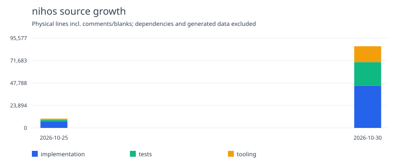
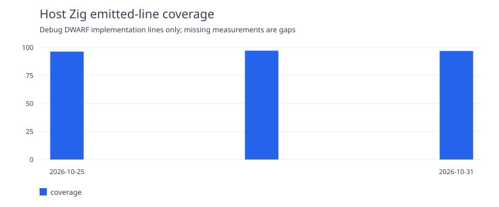

# nihos

> 素のハードウェアを、色づける。

**nihos** is an experimental, small, educational operating system for the
M5Stack Tab5 and its ESP32-P4. It is intended to explore a readable Zig-first
system that uses the hardware well without hiding the important mechanisms
behind a large framework.

The normal Tab5 image boots directly into nihOS through the stock ROM and
ESP-IDF second-stage loader. After `nih_native_start`, Zig/assembly owns both
cores, traps, timers, scheduling and native drivers permanently; there is no
FreeRTOS application runtime to return to. The normal profile opens a launcher
with a bounded shell, boot log, memory view and per-core counters. Display,
touch, keyboard, C6 Wi-Fi/BLE, RTC and board sensors have native paths; finite
speaker, microphone and UART/RS485 operations are available on demand.

This remains an experimental OS. Host tests, emulator execution and physical
Tab5 measurements cover different boundaries. Peripheral quality, persistent
SQLite, application isolation and long-duration reliability are not implied by
a successful build. The ESP-IDF-hosted windows remain comparison fixtures.

## Name

The name is pronounced **ニホス**. It comes from the classical Japanese verb
「にほす（匂す）」—to dye or give colour—and ends naturally in `os` when its
final `u` is removed for the project name.

The older sense is visual rather than merely olfactory: to make something
take on colour or radiance. That is the intent here—to make bare hardware
expressive while keeping the machinery visible to the reader.

## Direction

- Use Zig 0.17.0 for the kernel, HAL, and native services.
- Keep C and assembly boundaries small and explicit where the vendor SDK,
  boot path, or hardware support requires them.
- Keep the platform boundary as a small handwritten C ABI so that C and Rust
  comparison implementations remain possible without leaking ESP-IDF types
  into the kernel.
- Use both ESP32-P4 cores deliberately, with measured SMP costs and benefits.
- Prefer low overhead and simple invariants over server-grade security
  machinery, while using static analysis and hardware isolation where useful.
- Treat graphics and input latency as first-class concerns; Quake near 60 FPS
  is a performance target, not a current claim.
- Keep the source readable enough to serve as an operating-systems text.
- Choose the flash filesystem from measurements and failure tests rather than
  assuming m5fs, littlefs, or another design in advance.

The language decision and its validation gates are recorded in
[`docs/adr/0001-zig-first.md`](docs/adr/0001-zig-first.md). The initial system
layers and hardware boundary are described in
[`docs/architecture.md`](docs/architecture.md).
Permanent native boot and scheduler ownership are defined in
[ADR 0018](docs/adr/0018-independent-native-boot.md) and
[ADR 0019](docs/adr/0019-permanent-native-task-owners.md). Native IPI/WFI and
opt-in floating contexts follow in
[ADR 0020](docs/adr/0020-native-ipi-and-interrupt-wait.md) and
[ADR 0021](docs/adr/0021-native-opt-in-floating-contexts.md).
See the [native boot guide](docs/native-boot.md) for build profiles and
[architecture](docs/architecture.md) for service and evidence boundaries.
Earlier [ADRs](docs/adr/) preserve the progression from hosted windows to the
permanent native runtime.

The normal device image includes
[connectivity and board devices](docs/adr/0047-default-connectivity-and-board-devices.md),
[on-demand speaker, microphone and RS485 drivers](docs/adr/0052-default-on-demand-device-drivers.md),
and [SNTP-to-UTC RTC synchronization](docs/adr/0053-network-time-to-rtc.md).
SQLite has a [bounded single-owner memory session](docs/adr/0040-bounded-single-owner-sqlite-session.md)
and an [opt-in native execution fixture](docs/adr/0042-native-sqlite-flash-execution.md);
a persistent `sqld` task/RPC and production VFS remain future work.

## Project metrics





CI tracks source size and host Zig execution coverage. See the
[measurement scope and local commands](metrics/README.md) and
[current summary](metrics/summary.md). Host coverage is limited to emitted
Debug test-binary lines; emulator and physical Tab5 evidence remain separate.
To compare current local source trees, run
`python3 tools/metrics.py --compare ../MeOS`.

## Build and checks

Build the normal interactive Tab5 image with the pinned ESP-IDF v5.4.4 loader
and toolchain setup from the [native boot guide](docs/native-boot.md):

```sh
sh tools/build-native.sh device
```

This packages a candidate; it does not install it on a device.

Install the pinned Zig toolchain into the ignored `.tools/` directory:

```sh
sh tools/bootstrap-zig.sh
```

Run the host-side Zig tests and the same ABI probe implemented in C, Zig, and
Rust:

```sh
sh tools/run-static-analysis.sh
.tools/zig-0.17.0/zig build test
sh tools/run-language-probe.sh
```

Static analysis also compile-checks the architecture contract for the pinned
RV32IMAF target, so a host ABI success cannot hide a target layout/type error.

The language probe verifies the ABI boundary; it does not measure Tab5
performance. The first host baseline is recorded in
[`docs/measurements/2026-10-25-language-probe-host.md`](docs/measurements/2026-10-25-language-probe-host.md).

The fast hosted CI gate runs formatting, ZLint, ShellCheck, Debug and
ReleaseSafe Zig tests, and the three-language ABI probe. ZLint is pinned and
checksum-verified by `tools/bootstrap-zlint.sh`; its selected semantic rules
are warnings-as-errors. This gate requires no target hardware.

For a single entry point to the interactive UI simulator and native RV32 canvas checks, see the [development simulator guide](docs/development-simulator.md).

For card-screen development without a Tab5, run the local host simulator:

```sh
python3 tools/card_sim/app.py
# Open http://127.0.0.1:8711
python3 tools/card_sim/app.py --application normal
# Or select normal UI in the page header
python3 tools/card_sim/app.py --headless build/card-sim/evidence
```

It executes the production Zig rendering/input and C SRAM/DMA publication code
with synthetic card data and modeled registers. The browser shows pixels
reconstructed from the DMA descriptors; scenarios cover EOF handoff, capacity
rollback, stuck retirement, and deliberate pixel corruption. See the
[card simulator guide](docs/card-ui-simulator.md) for replay, base-image SRAM
budgets, evidence, and the boundary between host simulation and target emulation.
Normal mode also runs the production splash/log rendering and rotated pointer
stream through the gray LOGS/SPLASH control. Its input traces reproduce holds,
drags, multiple contacts and queue overflow. Card result-page controls are
shared with the native application and work directly inside the canvas.

Run the ESP32-P4 core smoke under the pinned official Espressif emulator with:

```sh
sh tools/run-esp-emu-smoke.sh
```

This builds a separate revision-3 ESP32-P4 image, boots both emulated cores,
and checks the 100,000-message SMP mailbox. The corresponding hosted workflow is manual; permanent native boot has its
own smoke and qualification profiles. An
emulator pass is target-execution evidence, but it is not evidence for Tab5
power, DMA, display, touch, audio, SD, timing, or physical-device reliability.
The initial result is recorded in
[`docs/measurements/2026-10-25-esp-emu-core-smoke.md`](docs/measurements/2026-10-25-esp-emu-core-smoke.md).
The first scheduler-policy and periodic-interrupt results are recorded in
[`docs/measurements/2026-10-25-scheduler-policy-host.md`](docs/measurements/2026-10-25-scheduler-policy-host.md)
and
[`docs/measurements/2026-10-25-esp-emu-periodic-timer.md`](docs/measurements/2026-10-25-esp-emu-periodic-timer.md).
The corresponding ESP-IDF-hosted physical timer result is recorded in
[`docs/measurements/2026-10-25-tab5-periodic-timer.md`](docs/measurements/2026-10-25-tab5-periodic-timer.md).

Build the separate ESP-IDF bring-up oracle using the pinned ESP-IDF v5.4.4 setup:

```sh
sh tools/build-espidf.sh
```

This firmware currently lets ESP-IDF perform boot and FreeRTOS SMP startup,
then crosses the handwritten C ABI into Zig and prints the detected chip,
heap, PSRAM, and Flash information. Zig then owns bounded internal-RAM and
PSRAM arenas, exercises the platform cache-sync contract, and verifies
memory-to-memory AXI-GDMA across internal RAM and PSRAM. It then paints a
bounded RGB565 test pattern from Zig into the display driver's scanout buffer
without an intermediate full-frame copy and measures physical refresh events.
This oracle runs under FreeRTOS; the normal native image uses its own scheduler. The
physical-device results are recorded in
[`docs/measurements/2026-10-25-espidf-zig-bootstrap.md`](docs/measurements/2026-10-25-espidf-zig-bootstrap.md)
and
[`docs/measurements/2026-10-25-tab5-display-scanout.md`](docs/measurements/2026-10-25-tab5-display-scanout.md).
The first idle touch-poll result is in
[`docs/measurements/2026-10-25-tab5-touch-bootstrap.md`](docs/measurements/2026-10-25-tab5-touch-bootstrap.md).

## Native launcher

The live native integer normal-boot profile now opens a small launcher after
initialisation. Escape opens an ASCII shell; `exit` returns to the launcher.
Shell, boot logs, CPU0 memory usage and per-core runtime counters are available.
See [native session behaviour and build flags](docs/native-session.md).
Physical results qualify the exact candidates recorded in the measurement
files; new builds require their own input/display validation.

## Project boundary

nihos is a new, independent project. It is not MeOS and is not presented as a
work by MeOS author shi3z.

No MeOS source code is included in this initial repository. Any future reuse
of a HAL, driver, or other implementation must first have a verified license
or explicit permission, preserve attribution, and document the imported
boundary and modifications.

Sources used as specifications, references, or dependencies are recorded in
[`provenance.toml`](provenance.toml). A source marked `reference-only` must not
be copied into the repository.

## Repository policy

- The repository is public from its first commit.
- The fast host CI gate runs on every pull request and push to `main`.
- The ESP32-P4 emulator smoke is manually dispatched until it becomes a
  stable, useful gate for the native kernel rather than ESP-IDF bring-up.
- Hardware claims require measurements on a physical Tab5; host builds and
  simulators will be reported separately.

## License

Original nihos code and documentation are available under the
[MIT License](LICENSE) unless otherwise noted. Third-party components, if
introduced, will retain their own licenses and notices.

Normal native Tab5 builds now enable connectivity by default:
`sh tools/build-native.sh device`. A private `NIHOS_C6_WIFI_CONFIG` JSON is
optional; without it Wi-Fi waits for settings while BLE discovery can run.
See [ADR 0047](docs/adr/0047-default-connectivity-and-board-devices.md) and the
[device support inventory](docs/planning/tab5-native-device-support.md) for
implemented features and remaining gates.

The normal interactive device build also includes a camera preview prototype.
Press Escape to open the shell, then use `camera` for a snapshot or
`camera-live` for automatic updates; press a key to close it. The current
preview is sampled grayscale and repeats finite captures; two finite Tab5
trials measured about 4.8 updates per second. Set
`NIHOS_NATIVE_CAMERA_ID=0` to omit it. Detailed camera diagnostics remain an
explicit fixture profile. See the [normal-profile camera trial](docs/measurements/2026-10-30-camera-normal-profile.md)
for the original tested configuration and remaining limits, and the
[cadence and stop update](docs/measurements/2026-10-30-camera-preview-cadence.md) for follow-up measurements.

Normal native Tab5 boot also initializes BMI270 and acquires acceleration and
gyroscope readings through the shared board I2C owner. See
[ADR 0048](docs/adr/0048-native-bmi270-acquisition.md) for sensor-frame raw values,
the licensed configuration data and remaining motion/calibration gates.

An experimental finite audio-output probe can be built explicitly with
`NIHOS_NATIVE_AUDIO=1 sh tools/build-native.sh device`. The normal image includes the same finite output driver through the on-demand
service; playback waits for an explicit request. Its native codec/DMA transfer and shutdown have physical evidence;
audible output is still unconfirmed. See
[the audio checkpoint](docs/measurements/2026-10-28-native-audio.md).

An opt-in finite ES7210 microphone input probe uses
`NIHOS_NATIVE_MICROPHONE=1 sh tools/build-native.sh device`. It reports only
local PCM statistics after DMA ownership returns, then clears the buffer.
A separate `NIHOS_NATIVE_MICROPHONE_MUTED=1` build is the all-zero control.
See [ADR 0050](docs/adr/0050-native-finite-microphone-input.md) for the finite
input boundary and remaining acoustic/streaming gates.

A finite UART1/RS485 foundation probe is opt-in with
`NIHOS_NATIVE_RS485=1 sh tools/build-native.sh device`. Its default mode is
internal UART loopback with external transmit disabled; it does not establish
RS485 wire support. See [ADR 0051](docs/adr/0051-native-rs485-bounded-exchange.md)
for the timeout control and separate-adapter peer test.
