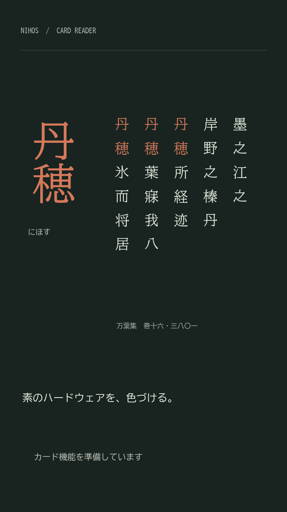
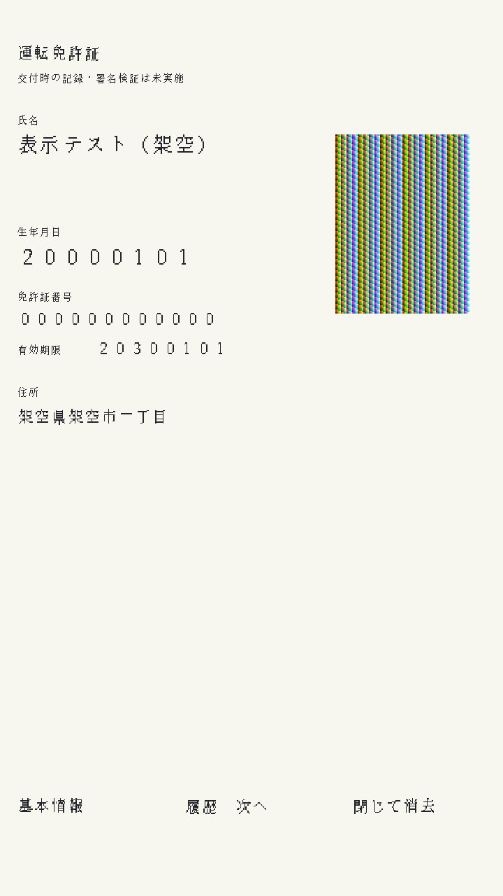

# Card UI host simulation, 2026-10-28

This run used macOS arm64, Python 3.9 and pinned Zig 0.17.0. No physical device
was opened, flashed or tested. Work was isolated on `codex/card-host-emulator`
based on `ce74fc3`; concurrent work in the primary checkout was left alone.

## Results

| Check | Local result |
| --- | --- |
| Headless fixture/EOF/fault/pixel contracts | 11 / 11 passed |
| Imported native-card base audit budget | 12 / 12 including the extra audited-budget scenario |
| Python regressions | 257 passed, including 14 simulator/HTTP tests |
| Zig Debug and ReleaseSafe tests | Passed |
| Static analysis and six audited RV32 ELF links | Passed |
| Card-free scene-exercise firmware build and image audit | Passed; not flashed |
| Pinned ESP-EMU, native integer smoke, PSRAM=0 | Passed, 300 rounds plus lifecycle/IPI/idle/owned memory |
| Linux x86_64 shared-library cross-links, Zig and C | Passed; not executed on Linux here |
| Browser JavaScript syntax | Passed with `node --check` |
| Generated boot/overview PNG inspection | Passed |
| Interactive browser visual check | Unavailable: computer-use browser inventory was empty |
| Hosted CI and physical Tab5 | Not run for this change |

The final host source identity is
`70b13998f557b1b97650000a07f99be855d4b35099f4d259d4ed17f785d6f206`.
The [source/compiler/library receipt](evidence/2026-10-28-card-host-simulator/source-witness.json)
and [scenario report](evidence/2026-10-28-card-host-simulator/report.json)
bind the result to the loaded libraries. The browser API returned the same
identity; its raw frame hash matched the state response.

The [audited-budget report](evidence/2026-10-28-card-host-simulator/audited-report.json)
imports extents from the [native card image audit](evidence/2026-10-28-card-host-simulator/card-image-audit.json).
Both built-in SRAM templates completed the synthetic portrait lifecycle with
zero pixel mismatches and zero modeled backlight-off events. Capacity rejection
kept the previous frame and SRAM digest. A stuck DMA retained its leases and
denied shutdown until the injected stuck condition was cleared. FIFO/lane
timeouts also retained ownership at the failed retirement point. The report
retains before/failure/shutdown observations for these contracts. Deliberately
flipping a source word produced a nonzero mismatch, establishing a negative
control for the pixel oracle.

The first direct card ELF build attempt lacked its SDK-generated `sdkconfig.h`.
Its [failure log](evidence/2026-10-28-card-host-simulator/initial-elf-attempt.log)
is retained. Running the normal build wrapper generated the loader configuration
and completed the ELF, image and manifest audits successfully. No flash command
was run. The [RV32 smoke report](evidence/2026-10-28-card-host-simulator/rv32-smoke-report.json)
is separate target-emulation evidence; it does not exercise the host card UI.

## Reproduce

```sh
python3 tools/card_sim/app.py --headless build/card-sim/evidence
python3 -m unittest discover -s tools -p '*test.py'
sh tools/run-static-analysis.sh
.tools/zig-0.17.0/zig build test
.tools/zig-0.17.0/zig build test -Doptimize=ReleaseSafe
sh tools/run-native-smoke.sh integer 0
NIHOS_NATIVE_NETWORK=0 NIHOS_NATIVE_USB=1 NIHOS_NATIVE_DISPLAY=11 \
  NIHOS_NATIVE_CARD_AUTO_PROBE=1 NIHOS_NATIVE_CARD_SCENE_EXERCISE=1 \
  sh tools/build-native.sh device integer
python3 tools/card_sim/app.py --base-audit build/native-device/image-audit.json \
  --headless build/card-sim/audited-evidence
```

See the [simulator guide](../card-ui-simulator.md) for browser controls and
limitations. The host adapter models register predicates and a logical DMA
descriptor layout. Zero modeled flicker is not an optical measurement. Real
card/PIN/APDU behavior, physical cache coherency, display timing and interactive
browser visual QA remain separate acceptance gates.




