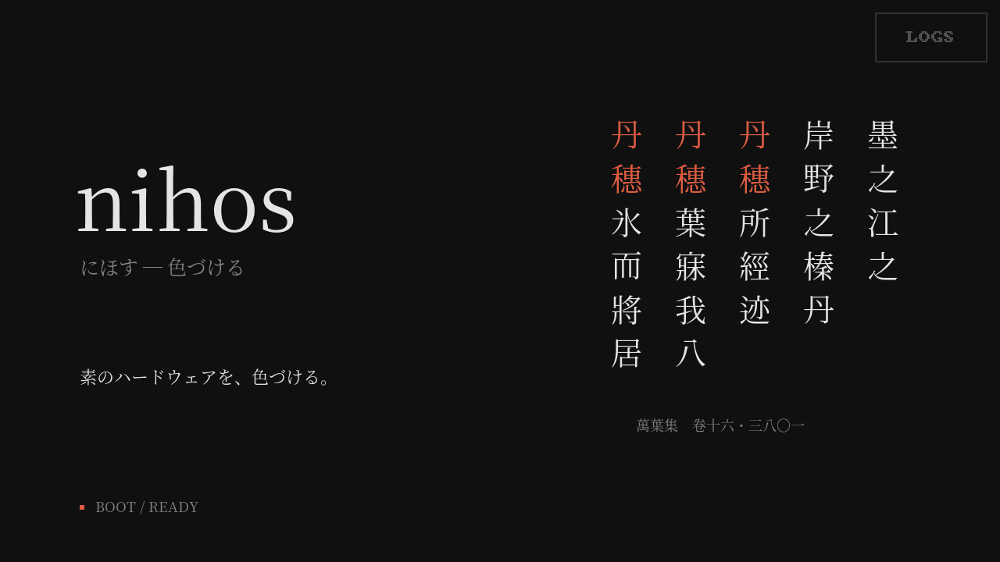
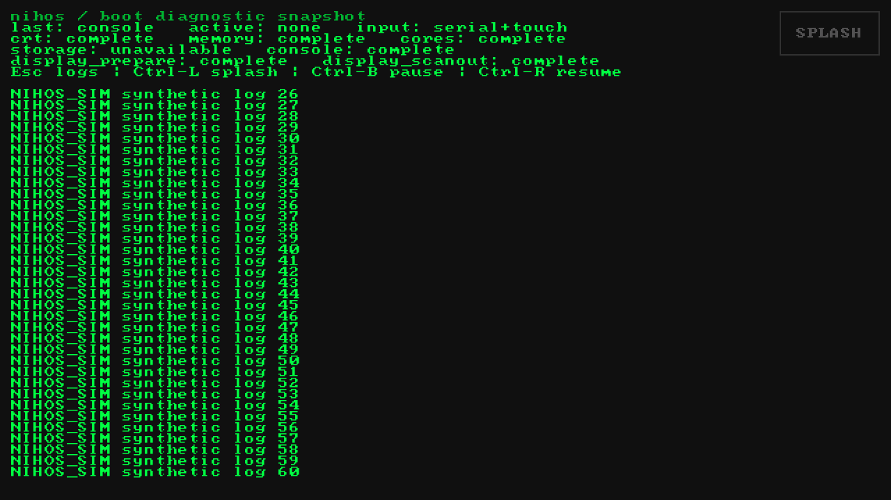

# Normal UI and card-result host input, 2026-10-28

The host simulator now runs the normal landscape splash/log view, in addition
to the portrait card fixture. This run used macOS arm64 and pinned Zig 0.17.0.
No physical Tab5, touch controller, USB reader or card was accessed.

## Implemented scope

Normal mode imports the production boot-state model, pointer rotation, stream,
queue, release-gated button, splash painter and console renderer. It compares
the incremental console output with a full repaint. Its frame boundary is a
host publication model, with no native PSRAM/cache/DMA/timing claim. Synthetic
boot checkpoints and logs are explicitly marked in the interface.

The card result controller was extracted from `card_auto.waitForDismiss` into
`card/result_input.zig`, keeping its existing hit regions and contact gate.
Both the native owner and host fixture use it. My Number results dismiss on
any tap; licence results support basic/next/close. The host licence fixture
has one synthetic history page. Card rendering still passes through the real
sparse C builders and descriptor/SRAM pixel reconstruction.

Normal pointer traces contain bounded coordinates, contact count, time delta
and dispatch policy, with an explicit application marker. Card/PIN traces
remain semantic and reject coordinates. The HTTP tests verify that a normal
trace cannot be replayed into the card endpoint.

## Results

| Check | Result |
| --- | --- |
| Python regression suite | 277 passed, including 27 simulator/HTTP cases |
| Headless card contracts | 14 / 14 |
| Headless normal-UI contracts | 9 / 9 |
| Zig Debug and ReleaseSafe | Passed |
| Formatting, ZLint, static analysis and six audited RV32 links | Passed |
| JavaScript syntax check | Passed |
| Native card-scene build/image audit | Passed; 57,728-byte static heap |
| Native read-enabled automatic-card build/image audit | Passed; 50,048-byte static heap |
| Physical image installation / qualification | Not performed |

The final host source/compiler identity is
`13a39f16fd8def52854064c54f20d457a1a013f5e93cef0ae42d284f2d280051`.
The [receipt](evidence/2026-10-28-normal-ui-host/source-witness.json),
[normal report](evidence/2026-10-28-normal-ui-host/normal-report.json), and
[card report](evidence/2026-10-28-normal-ui-host/card-report.json) bind these
results to the loaded host libraries. Both native image audits are retained
separately; they establish build/layout results, not physical acceptance.

Normal cases cover touch roundtrip, outside/drag/multiple/held contacts, stale
input, queue overflow and quarantine, a subsequent ordinary tap, manual frame
publication, five palettes and incremental scrolling, deterministic replay,
and synthetic failure. Corrupting one log byte produces a nonzero mismatch;
the candidate is withheld and full repaint repairs it. Card cases exercise
result controls, drag/multiple-contact rejection, any-tap dismissal, and
semantic replay without PIN coordinates.

## Browser observation

Chrome was operated through native computer-use input against the loopback
server. The browser-host connector was unavailable, but native Chrome access
worked. The actual canvas LOGS/SPLASH control switched views on release; a
1.7-second hold and drag-out did not switch. An ordinary tap still worked.
The card canvas accepted count-only dummy input, then its history/basic/close
controls reached details, overview and ready with zero pixel mismatches.

Those browser input traces were replayed into the final source and reproduced
the same states, including frame hashes and input counters. The final browser
also displayed the corruption error and recovered through retry/full repaint.
These are browser/host observations, not device optical or latency evidence.
Retained browser traces contain only synthetic UI input. PIN coordinates and
digit values are absent from the card trace.

## Reproduce

```sh
python3 tools/card_sim/app.py --application normal
# http://127.0.0.1:8711/?app=normal (card view is linked in the header)
python3 tools/card_sim/app.py --headless build/card-sim/evidence
python3 -m unittest discover -s tools -p '*test.py'
```

The [guide](../card-ui-simulator.md) describes the two trace formats, frame
boundary controls and evidence limits. The host service used for this review
is on port 8712 to keep the earlier simulator session separate.




