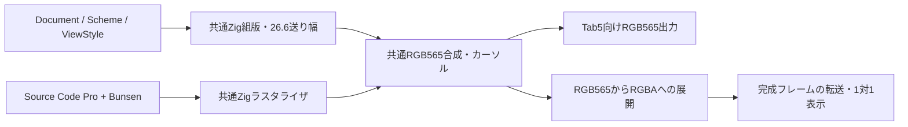

# xyの共通描画とMacでのdot-by-dot表示

英数字が日本語本文用の字形と送り幅で広く並び、さらにMacのRetinaで
フレーム全体が2倍に拡大されていた。英数字へSource Code Proを優先し、
共通RGB565フレームの1ピクセルをMacの1 backing pixelへ対応させた。

## 何を共通にしたか



GPUI上でホストの文字描画を再現する設計にはしない。GPUIの役割は入力と
完成フレームの転送で、glyph解決・ラスタライズ・配置・alpha合成は共通Zig側に置く。
現時点の操作ウィンドウは引き続きCocoaであり、GPUIランタイムへの接続は未実装。
ホストのボタン・タイトル・状態表示は対象画面の外にある操作部として扱う。
今回の一致判定は対象画面のフレームバッファで、ホストの操作部を含めない。

## 英数字の字形と幅

`graphics/code_font.zig` は、既存コンソールの生成元と同じSource Code Pro Mediumを
`ttf.zig` に渡す。フォント自体は既存の `fonts.json` に記録されたupstream commitと
同じbytesで、SHA-256は
`f9dbc746f60c83f5cb1503b19f90729d8195cab6bb67f2b861d4eb257ed86536`。
OFL本文は既存の `SourceCodePro-LICENSE.md` を保持する。

Mac用のsystem fontやCoreTextで対象画面の字形を作っていない。日本語は
既存Bunsenの本体・Ext・PUPへfallbackする。共通のfamilyに同じフォント列を
渡すため、RGB565とMacの転送経路でglyph解決も同じになる。

ソース表示は25pxを初期値とし、英数字と空白が15pxの等幅で並ぶ。タブは4空白。
改行間隔もコード向けに詰める。終端カーソルの位置もem正方形ではなく、
配置済みglyphの実際の26.6 advanceを使う。`PlacedGlyph` の末尾に
`inline_advance_26_6` を加え、C側宣言も更新した。

既存の診断コンソールの生成済みbitmapやデフォルト書体は変更していない。
今回のxy経路は共通Zigのアウトライン描画を使うため、生成時FreeTypeで作った
コンソールbitmapと同じピクセルになるという意味ではない。

## フレーム全体の一致

以前はRGBA経路が独自にalpha合成し、RGB565経路はlinear blendを使っていた。
共通のmaskと座標だけを渡しても、この差で完成画素は一致しなかった。

`xy_host_render_rgba8` は現在、`xy_host_render_rgb565` の完成フレームを
`graphics/pixel_transfer.zig` でRGB888へbit展開し、alphaを255として転送する。
別の文字合成をしない。RGB565化した色精度が両側の基準になる。
転送用scratchはMacのC-ABIホストにあり、1280×720×2 bytesの固定上限。
Tab5の常駐メモリへこのscratchを追加する変更ではない。

空のDocumentも背景とカーソルを描けるようにした。未知の文字や容量不足は
エラーとして残し、空の文書を描画エラーにしない。

## Macの表示倍率

仮想画面は1280×720。Retinaの2x画面なら640×360 pointsへ描き、画面の周囲に
余白を置く。`convertRectToBacking` / `convertRectFromBacking` を通して
整数ピクセルへ合わせ、CoreGraphicsの補間を無効にする。画面のbacking scaleが
変わった場合はウィンドウと操作部を配置し直す。

この1対1対応は画素配置の条件であり、実ディスプレイの色特性や視野角まで
一致させるものではない。別ディスプレイ間のscale変更はコードで扱うが、
今回GUIで確認したのはMacの2x Retina画面である。

## 再現

```sh
tools/build-xy-mac.sh
open build/xy-mac/xy.app
XY_RENDER_EVIDENCE_DIR=build/xy-mac/pixel-evidence \
  python3 tools/xy_workspace_test.py -v
.tools/zig-0.17.0/zig build test -Doptimize=ReleaseSafe --summary all
```

Macの外部Bunsenパックへの依存は前のワークスペース実装と同じ。Source Code Proは
リポジトリ内に固定してある。フォントパックがない環境では、結合試験の実フォント
描画をskipするので、skipを実描画成功として扱わない。

全画素比較は、1280×720の英数字・日本語混在文、横書き＋明るい配色と
縦書き＋暗い配色を使う。RGB565のbit展開とMac向けRGBAを1,843,200 pixelsに
わたり比較し、カーソルと背景も含め一致を要求する。stride末尾の保護bytes、
無効なgeometryで書き込まないこと、空のDocumentも確認する。
別の単体試験でRGB565全65,536色の展開と逆変換が一致することを確認する。

Mac上の共通renderer出力を比較した試験であり、Tab5実機の画面・入力タイミング・
色特性の資格試験ではない。Tab5の通常起動画面へこのfamilyを接続する作業も
今回には含めない。

最終結果は結合試験 **14件成功**（実フォント描画をskipせず実行）、
Zig **67/67 build steps成功**、変更した8 Zigファイルのlint
**0 errors / 0 warnings**。`zig fmt --check`、shellcheck、`git diff --check` も成功。
全画素比較は **1,843,200 pixels / mismatch 0**、RGB565全色の変換も成功した。
2x Retina上の実際のCocoaウィンドウで、間延びしないSource Code Proのソース表示を
確認した。原mainのHEAD・status・未コミット4ファイルのhashは作業前と一致し、
前のワークスペース実装ブランチもcleanのまま保持している。

[evidence/result.json](evidence/2026-10-31-xy-pixel-host/result.json) に
ソース・実行ファイルのhashと検証範囲を記録した。
[横書きの共通フレーム](evidence/2026-10-31-xy-pixel-host/horizontal-0.png) と
[縦書きの共通フレーム](evidence/2026-10-31-xy-pixel-host/vertical-1.png) は
実際のrendererの出力であり、Macのウィンドウを撮った画像ではない。

参照元：[Adobe Source Code Pro](https://github.com/adobe-fonts/source-code-pro)、
[GPUI](https://github.com/zed-industries/zed/tree/main/crates/gpui)。


## Native integration follow-up

The main-landing integration uses PR #87's native render session and its view
contract. Both Mac and Tab5 now enter that same session; desktop logical rows
and the native rotated scanout are compared after orientation normalization.
A 10,184-byte ASCII recovery subset replaces the full font as the runtime
input on both targets. Every printable ASCII glyph is checked against the
pinned original at 8/25/64/96 px, horizontally and vertically. The original
full TTF remains a test/provenance input. Native recovery Japanese faces are
also used for the desktop device-compatible canvas, so that external full
Bunsen packs do not silently change its fallback coverage.

Earlier evidence in this file names the earlier independent Mac commit;
final-head and physical evidence is recorded separately in the native landing
report. The earlier 512-glyph full-document limit is replaced by the shared
bounded viewport that follows the cursor. Native persistence remains outside
this rendering landing: Mac workspace SQLite is writable, native normal
storage remains read-only.

最終統合と実機確認は[共通画素描画のlanding記録](2026-10-31-xy-native-pixel-landing.md)を参照。
