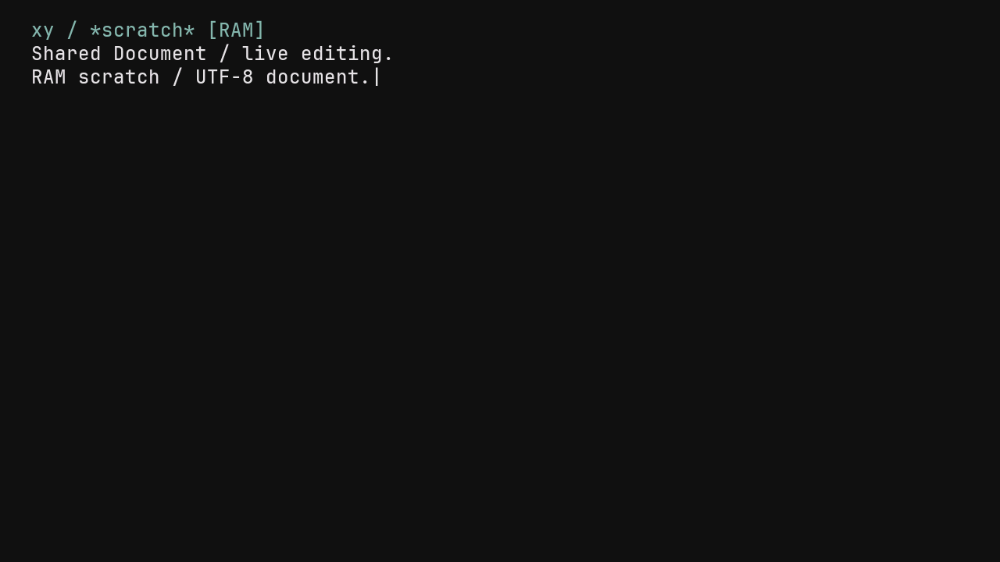

# xy RAM scratch as the normal device startup

The public ordinary device build now completes the splash and opens `xy`'s
editable `*scratch*` directly. It does not enter the launcher or ASCII shell.
The screen has one header, the document/caret and a bottom minibuffer/status
row; help appears only when requested. The default xy font is the existing
30 px JetBrains Mono raster (80 columns, 22 rows), with explicit font overrides
preserved. This is the first RAM workspace, not the finished Scheme environment.

## Shared model and input

`src/xy/scratch.zig` owns the existing shared `Document`, not a second cell-based
editor. Its current bounds are 4,096 UTF-8 bytes, 256 undo operations and 2,048
bytes of deleted-text undo data. Undo exhaustion reports a status instead of
discarding text; the explicit `forget-undo` minibuffer command releases history.
`Document.forgetUndoHistory` preserves text, cursor, annotations, preedit and
revision. Arrows, Enter, Backspace, forward deletion and undo use Document APIs.

The reused serial/HID decoder adds Left/Right and Ctrl-Z. The xy frontend also
assembles serial UTF-8 scalars before insertion. IVS/combining-cluster operations
use the shared Document boundaries. `Esc` opens the minibuffer; `help` opens a
temporary help view and returns without replacing the document. These initial
built-in actions are a transitional controller, not a Scheme command registry.
Scheme expressions report that evaluation is not connected.

The existing fixed-cell/Canvas raster is the initial presentation adapter.
Non-ASCII graphemes are displayed as `?` while their original UTF-8 is retained.
Paged OpenType rendering, IME, persistence, read-only system buffers and a full
Scheme VM are subsequent integrations. This does not claim complete Unicode
segmentation or Japanese text rendering.

Once the workspace starts, serial colon text goes to the document. Legacy
`:storage`/`:devices` parsing cannot intercept code being edited. Boot/fault
records remain independent of xy. `NIHOS_NATIVE_XY_WORKSPACE=0` explicitly
selects the old diagnostic startup. Explicit camera-qualification profiles also
retain that startup unless xy is requested. The standard camera diagnostic
profile (`CAMERA_DIAGNOSTICS=0`) still builds and passes its image audit.

The workspace initializes in place in the existing display reservation's PSRAM
tail, before the separate networking reservation. Compile-time bounds and
alignment checks prevent overlap. No new primary-heap reservation is added.
The measured native workspace is 12,656 bytes. The ordinary default image retains
50,752 bytes of primary heap; the trace qualification image retains 50,624 bytes,
both above the unchanged 49,152-byte gate. Reserved framebuffer/display memory
is unchanged. No whole-call-stack or integrated VM memory qualification is made.

## Executed checks

- ReleaseSafe host root validation completes all 61 build/test steps. The
  retained run reports 752 executed tests with other artifacts cached. An
  earlier uncached run passed 927 tests before the final byte-boundary change;
  these counts are not summed or promoted into a new total.
- The focused console/Document/scratch tests pass in small mode (38 tests),
  including all 256 byte values at the foreign transport boundary, invalid
  integers, CRLF, edits/undo, IVS/combining deletion, exhausted history, modal
  return and cursor-following viewport behavior.
- `tools/run-xy-scratch-smoke.py` executes actual RV32 Document/input/raster
  code in ESP-EMU. Undo and help return restore the exact framebuffer hash;
  IVS deletion restores both text and pixels; colon text remains literal.
  Framebuffer guards stay intact. Its debugger snapshot is an 80-byte UTF-8
  prefix, not the document capacity. It does not execute the normal boot loop,
  panel/DMA, physical keyboard, storage or Scheme VM.
- Both ordinary and trace device images pass the native image audit. The
  modified files pass zlint, Zig formatting and shellcheck. Broker, checkpoint,
  checkpoint-service RV32 checks and the six native architecture links pass.

The global static-analysis entry point is **not green**: unchanged files from
the base have ten `unsafe-undefined` errors in `ttf.zig`/`ime_omni.zig` and one
`avoid-as` warning in `render_adapter.zig`. Those files are not modified here;
concurrent main-checkout font/layout edits were not absorbed. The verbose camera
profile (`CAMERA_DIAGNOSTICS=1`) also overflows its fixed Flash-record page on the
unchanged `be7fcca` baseline; the standard profile remains supported. Neither
baseline failure is relabeled as passing.

## Physical qualification and the byte-boundary defect

The final trace image was installed on the known ESP32-P4 Tab5 under the common
exclusive write lock and kernel serial exclusion. The exact frozen bootloader,
partition table and application were verified before and after the test. No SD
formatting, BLOB update or backup was performed under the existing overwrite
authorization. Both warm boots entered xy, with no launcher/session-ready marker.

Twelve observations check the submitted repaint's document byte count, cursor,
FNV-1a hash, mode and progressing frame count: initial xy, serial CRLF, Left,
insertion, Ctrl-Z undo, IVS input, whole-cluster Backspace, minibuffer, help,
help return, literal `:storage`, and empty RAM after a warm reset. No document
content is emitted by the trace. These checks prove the synthetic document
state and repaint submission, **not optical pixels or physical HID operation**.

The first two attempts remain unsuccessful in the evidence. They passed ASCII
editing but timed out at IVS input. The second counted seven incoming bytes
without a document update. Inspection of its linked poll function showed that
the high-bit UTF-8 branch had been removed at the signed C-result narrowing
boundary. The final shared `transportByte` validates 0..255 and uses an explicit
bit-preserving conversion, rejecting empty/error/out-of-range integers. The
final generated code retains the UTF-8 branch, the host byte tests pass, and
the final physical trial passes IVS insertion/deletion. This is an observed
candidate-specific code-generation result, not a general toolchain diagnosis.

`NIHOS_NATIVE_XY_TRACE=1` enables the synthetic state trace and puts the image in
a separate `-xy-trace` build directory. Normal builds omit the trace. The exact
trace image, not the untraced image, was physically qualified. Warm reset clears
this RAM scratch; nothing here qualifies file persistence, cold power loss,
Japanese glyphs, Scheme execution or a complete editor workflow.

Reproduce without a physical device:

```sh
zig build test -Doptimize=ReleaseSafe --summary all
python3 tools/run-xy-scratch-smoke.py
sh tools/build-native.sh device integer
```

For the bounded physical test, use the ESP-IDF Python environment after other
board owners release the shared lease:

```sh
NIHOS_NATIVE_XY_TRACE=1 sh tools/build-native.sh device integer
python tools/qualify-xy-scratch.py /dev/cu.usbmodem101 \
  build/native-device-network-devices-camera-xy-trace \
  /private/tmp/nihos-xy-qualification --install
```

The [evidence index](evidence/2026-10-31-xy-ram-startup/evidence-index.json)
binds input, audit, emulator image, logs and physical receipt hashes. Complete
firmware/captures remain private because network candidates can contain
credentials. Retained serial extracts include only boot/xy records.


