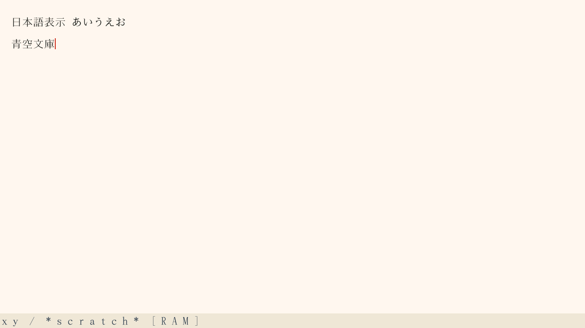
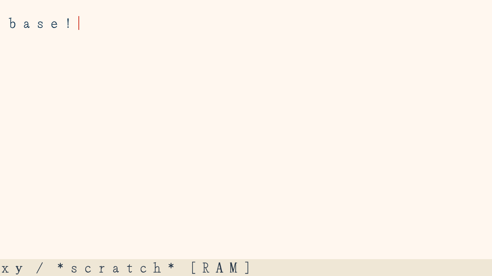
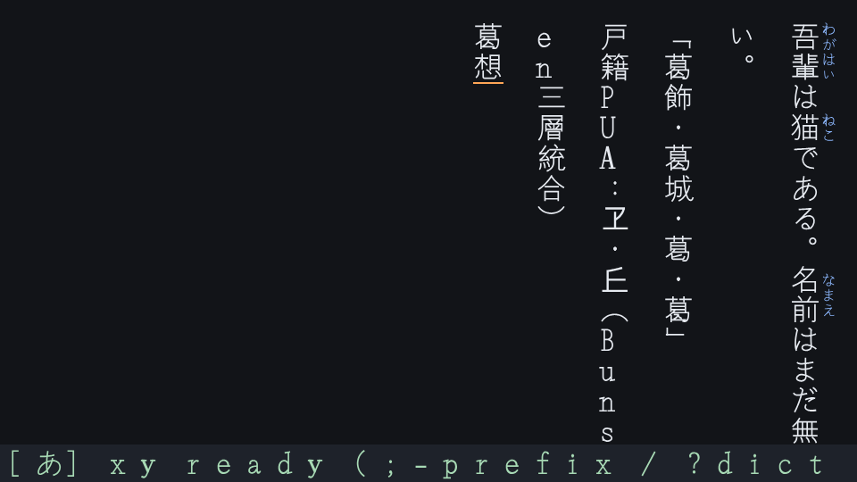

# xy: 共通 TrueType 描画と S 式の表示設定

実装コミット: `f0812e3`。カメラJPEG対応を含む最新main `3efd1f8` を `22b3a04` で取り込み、検証対象を `1afbc6c` に更新した。コードとフォントの SHA-256 は [RV32記録](2026-10-31-xy-render-integration/rv32-report.json)、イメージと証跡の識別子は [summary.json](2026-10-31-xy-render-integration/summary.json) に保存した。後続の証跡追加コミットは実行コードを変更しない。

通常の Tab5 xy と ESP-EMU fixture を `viewport_layout → TrueType cache/rasterizer → render_adapter → Surface` に接続した。本文、読み取り専用バッファ、help、コマンド行を同じ描画経路で表示する。借用した縦向き framebuffer を回転して使用し、第二 framebuffer を確保しない。macOS の下部バーにも同じ TrueType 処理と配色設定を適用した。

`view_config.zig` を共通設定の正本とし、native の bounded Scheme と desktop evaluator が同じ型・範囲検証を使う。フォント、文字・ルビサイズ、方向、余白・行間、本文・背景・ルビ・カーソル・下部バーの色、カーソル幅、下部バー余白、linear-light 合成を S 式で変更できる。複数指定の原子性、読み戻し、直近8回の rollback を検証した。[操作と全キー](../planning/xy-view-configuration.md)、[設定例](../../examples/xy/view.scm)。

## 確認結果

| 確認 | 結果 |
| --- | --- |
| `zig build test -Doptimize=ReleaseSafe -j4 --summary all` | 63/63 steps成功。描画実装時の822/822 tests成功後、main合成後も全体再確認成功 |
| Python unittest discovery | 最新main合成後506件成功 |
| coverage用Debug/LLVMビルド | 計測ツールの共通設定モジュール指定を補い、同じコマンドで750件成功 |
| static analysis | fmt、zlint、shellcheck、owner/codegen検査、6 native ELF監査成功 |
| native image | 通常版・XY_TRACE版・devices/storageを除いた版の3構成で独立監査成功 |
| RV32 ESP-EMU | 39観測。入力、改行、IVS削除、undo、help復帰、読み取り専用バッファ、Scheme、設定変更・拒否・rollback、日本語描画 |
| 実フォントの host test | 明朝・ゴシック、8/24/36/64/96px、横書き・縦書き、空白、未収録文字、長文、改行後と空白後のカーソル |
| macOS | Cocoa hostをビルドし、横書き明朝・縦書き明朝・縦書きゴシックの3 PNGを生成・表示確認 |

| native構成 | アプリイメージ bytes | primary SRAM heap bytes | xy Flash code bytes | xy Flash RO data bytes |
| --- | ---: | ---: | ---: | ---: |
| normal | 784272 | 49472 | 37088 | 253460 |
| XY_TRACE | 784736 | 49472 | 37456 | 253460 |
| minimal | 744320 | 68544 | 37024 | 263284 |

これは linker が確保した primary SRAM heap の値であり、実行中の空きメモリ測定ではない。キャッシュと128KiBの描画スタックは別のCPU0所有PSRAM leaseに保持する。mapped Flash の枠は384KiBに拡張し、コード・RO data・未知関数の混入・属性・イメージ一致を監査する。48KiBのprimary heap基準は維持した。

実行して初めて、大きなキャッシュ配列の値コピーが描画スタックを超えることを検出した。参照走査へ修正し、同じRV32経路で再確認した。文字サイズに応じた表示窓、行送りを含むカーソルアンカー、実際の空白advanceも追加した。

## 残る確認・接続

- 今回の候補の実機表示、実キーボード、display DMAとの並行実行は未確認。実機は別作業が利用しており、書込み・リセット・SD操作は行っていない。
- 通常起動の日本語はCC0 Bunsen由来のROM予備subset。収録範囲はfont manifestに限定し、完全な日本語書体・全IVSを実装済みとは扱わない。
- カスタムLFSのFontBLOBから完全なフォントを供給する接続、任意フォントの登録、設定の自動ロード・永続化は後続。現在のS式の変更はRAM内。
- 文書は4096 bytes、表示窓は最大240 grapheme。native/desktopのevaluator本体は引き続き別実装で、表示契約を共有する。
- C ABIの`PlacedGlyph`にadvanceを追加した。同梱Cocoa hostも同時更新しているため、利用側はライブラリとhostを一緒に再ビルドする。
