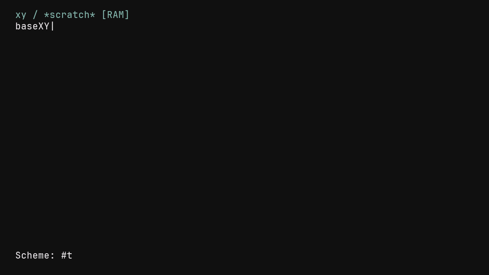

# Programmable xy commands with a bounded Scheme runtime

The native xy minibuffer now evaluates Scheme expressions and calls registered
commands. Definitions and lexical closures survive later requests and GC.
The existing `log`, `mem`, `tasks`, `undo` and `forget-undo` commands are installed
by Scheme bootstrap forms instead of a fixed native string-dispatch chain.

Press Esc, type an expression or command, then Enter. For example, evaluate:

```scheme
(define (make text) (lambda () (buffer/insert! text)))
(define stamp (make "Hello!"))
```

Then open the minibuffer again and enter `stamp`. It invokes that zero-argument
procedure and inserts its captured string at the shared Document cursor.
An explicit registry entry can replace a command immediately:

```scheme
(command/register! "stamp" (lambda () (buffer/insert! "updated")))
(command/register! "observations" (lambda () (system/tasks)))
```

`help`, `eval-buffer` and `reset-scheme` remain reserved frontend actions.
`eval-buffer` parses the whole source before executing, so an extension may
insert into the source Document without changing the text still being read.
`reset-scheme` discards definitions/registered replacements and reinstalls the
five defaults while preserving the Document. Startup resets this RAM runtime.
A failed bootstrap can report an error while basic native editing remains usable.

## Language and editor boundary

`src/xy/scheme_runtime.zig` is a separate allocation-free integer Scheme subset,
not an R7RS implementation. Supported forms are `quote`/`'`, `if`, `begin`,
variable/procedure `define`, lexical `lambda`, `set!`, parallel `let`, `and`,
`or`, and ordinary procedure application. Only `#f` is false. Procedures have
fixed, distinct parameters; closures retain mutable lexical environments.

The numeric primitives are checked signed-32-bit `+`, `-`, `*`, two-argument
`=` and `<`. List primitives are `cons`, `car`, `cdr`, `list`, `null?`, `pair?`
and `not`. Strings and identifiers retain their UTF-8 bytes. Reader support
includes comments, quote, strings and `\\`, `\"`, `\n`, `\t` string escapes.
The formatter escapes strings and bounds list/result traversal.

The editor primitives are:

| Procedure | Effect |
| --- | --- |
| `(buffer/insert! text)` | Insert UTF-8 at the shared Document cursor |
| `(buffer/move-graphemes! count)` | Move on existing Document cluster boundaries |
| `(buffer/undo!)` | Undo the previous edit group |
| `(buffer/forget-undo!)` | Explicitly discard bounded undo history |
| `(system/log)` / `(system/memory)` / `(system/tasks)` | Request a read-only snapshot |
| `(command/register! name procedure)` | Register or replace a zero-argument closure |

The registry owns the name/procedure references, and GC treats them as roots.
Unregistered global zero-argument user closures can also be called by name.
Command names are looked up directly; they are never concatenated into source.
Editing operations remain native Document calls, including IVS/combining-cluster
boundaries and read-only checks. A request groups ordinary insertions for undo; explicit history discard ends
that grouping. Execution errors retain earlier definitions and effects; grouping is not
transactional rollback, and partial edits remain undoable.

A binding test exposed signed-negation overflow in the existing Document API
when moving by `minInt(i32)`. Both grapheme and line movement now widen before
negating, then clamp naturally at document boundaries. Extreme signed movement
is covered directly and through the Scheme binding.

The minibuffer accepts 256 UTF-8 bytes, deletes whole existing Document clusters,
and shows the current input tail without scrolling the body. Overflowed commands
cannot execute a truncated prefix; cancel or edit them first. Results/errors
appear on the bounded status row. The fixed-cell raster still projects Japanese
clusters as `?`; this work does not add Japanese glyphs or IME.

## Limits and lifetime

| Resource | Current bound |
| --- | ---: |
| Caller-owned VM cells | 256 |
| UTF-8 bytes per string/identifier | 64 |
| Registered commands, including 5 defaults | 16 |
| Reader/evaluator nesting | 24 |
| Reader/evaluation ticks per request | 1,024 |
| Parsed source bytes | 4,096, subject to cell limit |
| Result formatting bytes | 128 |

Mark/sweep runs between requests, preserving globals, captured environments and
registry entries, including cycles. There is no collection within one request;
large expressions may exhaust cells. Depth, tick, arithmetic, reader and heap
errors return to the workspace, and a later request can run normally. Tick and
cell limits bound work; this is not a measured wall-clock deadline or a live
Ctrl-C cancellation mechanism. Proper tail recursion, macro expansion,
continuations, modules, the full numeric tower, standard Scheme libraries,
keymaps/hooks, file/SQL access and a user-mode sandbox are not implemented.

The earlier host `scheme_bridge.zig` fixed-form evaluator is unchanged. It and
the concurrent desktop/typography work have not been silently folded into this
runtime. View configuration, IME/SQL forms and the desktop C ABI still need an
adapter to this evaluator; their existing forms do not automatically work here.
MeOS's untracked Scheme workspace files were reviewed as a design reference for
bounded execution, lexical lifetime and between-request GC. No MeOS source or
library is linked; the reference snapshot and status are in `provenance.toml`.

## Native placement and verification

Foreground xy code and immutable runtime tables use an explicitly bounded Flash
region at `0x40060000..0x40080000`. The image auditor accepts only named runtime
and frontend entry points, RX code, read-only data and zero padding. It checks
linker extents, symbols, source-bound ordinary-FS identity, MMU offsets and exact
ELF/image payload equality. Adversarial tests reject wrong permissions, extents,
profiles, function names and unexplained gaps. The stock loader's two mapped
segments are preserved by contiguous, four-byte-aligned padding. No writable
or interrupt code was moved into this region.

Early builds were rejected by the existing SRAM/boot-page gates, or by esptool's
segment alignment/merging checks. Those outputs were never installed. Foreground
code was moved to the new section and the mapping was corrected; the original
49,152-byte primary-heap floor remains unchanged.

| Final image | Primary heap | xy Flash code | xy read-only tables |
| --- | ---: | ---: | ---: |
| Ordinary device | 49,984 B | 12,512 B | 736 B |
| Synthetic-state trace | 49,728 B | 12,512 B | 736 B |

The physical ready record reports a 38,176-byte native workspace, including the
Document, VM, snapshot and input state. It initializes in place in the existing
display PSRAM tail, with bounds/alignment checks before separate network state.
The fixed display reservation is unchanged. No full stack-watermark, arbitrary
program performance or future-VM capacity qualification is implied.

Executed checks:

- Focused ReleaseSmall console/Document/runtime suite: 49 tests passed. It covers
  closure capture/mutation/recursion, 600-request GC persistence sequences,
  registry replacement, all-forms reader staging, numeric/arity/depth errors,
  2,500 deterministic malformed requests, a real evaluation-budget failure,
  heap exhaustion/recovery, UTF-8 command names, grouped undo, self-editing
  source, command overflow and extreme signed movement.
- ReleaseSafe root suite: all 61 steps passed (763 executed tests in the retained
  run, with other artifacts cached). Counts from separate runs are not summed.
- Complete static analysis passes: formatting, zlint, shellcheck, broker,
  checkpoint/RV32 checks, network-owner codegen and six audited native links.
- The explicit legacy startup opt-out also builds and passes its audit.
- Both ordinary and trace images pass the native audit. Boundary tests include
  the new Flash profile; 38 native-image tests pass.
- ESP-EMU executes the real RV32 Document/input/raster/runtime and records 35
  observations. Captured closure insertion and replacement change the expected
  text; undo restores exact original pixels; a Scheme command opens a fixture
  system buffer and returns to identical pixels; a depth error returns and a
  subsequent edit succeeds. Frame guards remain intact. Diagnostic values are
  deterministic fixtures, not native memory/task observations.
- The exact trace candidate passes the bounded physical Tab5 test under the
  common write lock and kernel serial exclusion. Bootloader, partition table
  and application are frozen and verified before and after. Forty-five state
  observations cover startup, UTF-8/IVS editing, all three native system buffers,
  closure capture across requests, undo, command replacement, bounded depth
  error/recovery, Scheme system access and empty scratch after warm reset.
  These compare document/cursor/hash/mode/snapshot state after repaint submission.
  They do not establish optical pixels, physical HID or cold power loss.

No SD formatting, font BLOB update, persistence or backup is performed. The
untraced image is build/audit validated; the trace image is the physically
qualified candidate. [Evidence and identities](evidence/2026-10-31-xy-scheme-runtime/evidence-index.json)
retain the successful receipts. Complete firmware/network captures stay private;
retained serial extracts contain only boot/xy records.

```sh
zig build test -Doptimize=ReleaseSafe --summary all
sh tools/run-static-analysis.sh
python3 tools/run-xy-scratch-smoke.py
sh tools/build-native.sh device integer
NIHOS_NATIVE_XY_TRACE=1 sh tools/build-native.sh device integer
python tools/qualify-xy-scratch.py /dev/cu.usbmodem101 \
  build/native-device-network-devices-camera-xy-trace \
  /private/tmp/nihos-xy-scheme-qualification --install
```


