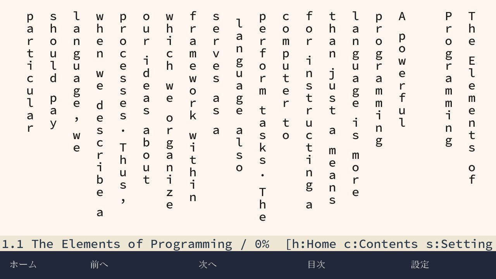
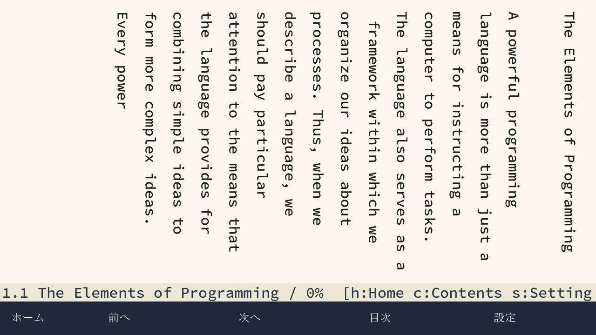

# 縦書き本文の英文を横倒しで読む

縦書きで英字を1文字ずつ正立させて全角送りする表示を改め、横書きの字形・字送りを
時計回りに90度回転して描くようにした。MacとTab5の共有TrueType描画に反映する。
親コミットは `c85d7ed`、ブランチは `codex/xy-sideways-latin`。
元の作業ツリーの未コミット変更には触れていない。

日本語の縦書きに英文を横倒しで組む方向は、
[Unicode UAX #50](https://www.unicode.org/reports/tr50/tr50-35.html)を参考にした。
Unicode全体のVertical_Orientationデータを実装したものではなく、ASCIIの英数字・記号、
Latin-1 Supplementの欧字、Latin Extended-A/B、Latin Extended Additionalを対象にする。
和文・全角約物・仮名のルビは既存の変換を使う。ASCII数字は横倒しにし、縦中横の自動判定はしない。

## 変更

- 横書き用の輪郭を共通の基線から回転し、横書きのadvanceを縦方向へ送る。
  1字ずつ全角セルの中心で回す方法を避け、単語の字間と基線がつながるようにした。
- 読書用の折り返しは、縦書きでは英字列に付随するASCII括弧・記号も一緒に扱う。
  列に収まらない長い識別子は既存の文字境界への折り返しを使う。
- キャッシュの横・縦キーを保つ。横書きへ戻した時に、回転したビットマップや縦送りを再利用しない。
- ページ全体を別画像へ展開する処理や、追加の描画バッファは導入しない。
  現在の横書きと同じフォント解決・字送りを使い、新しいカーニングや欧文合字のシェーパーは追加しない。

## 表示例

以下は実際のTab5用シーン描画コードをホストで動かしたSICPの同じ章。
実機写真ではない。

| 変更前 | 変更後 |
| --- | --- |
|  |  |

## 検証

- 最終ソースのZig ReleaseSafe host testsは73/73 steps、1019/1019 tests成功。
- ASCIIの全可視文字を16・25・32・64pxで描き、インク領域の幅と高さが回転で入れ替わること、
  縦送りが横書きのadvanceと一致すること、再び横書きにした時のmetrics一致を検査する。
- 狭い縦書き列で、英単語全体が次の列へ移り、その中の文字が12pxの横書きadvanceでつながることを検査する。
- Tab5共有シーンの8試験で全51項目の縦横表示と草枕第一章の連続読了を確認する。
  新しくSICPの収録3節を縦書きで最後まで送り、元UTF-8の欠落・重複がないことを確認する。
- Mac読書8件・ワークスペース16件、native image監査41件が成功。
- 変更したZig3ファイルのZLintは0 errors / 0 warnings。fmt・diff検査も成功。
- Tab5用trace候補のビルド・構造監査が成功。primary SRAM heapは49,216 bytes、
  ガード付き描画スタックは既存の262,144 bytesを保つ。
- 通常起動用のビルド・構造監査も成功。primary SRAM heapは49,344 bytes。

ログ・表示例・監査結果は [evidence/2026-10-31-xy-sideways-latin/](evidence/2026-10-31-xy-sideways-latin/)。

## 再現

```sh
zig build test -Doptimize=ReleaseSafe --summary all
sh tools/build-xy-tab5-preview.sh
python3 tools/xy_tab5_reader_test.py -v
sh tools/build-xy-mac.sh
python3 tools/xy_reader_test.py -v
python3 tools/xy_workspace_test.py -v
NIHOS_NATIVE_XY_TRACE=1 sh tools/build-native.sh device
```

実機検証用ツールには `--leave-book sicp` を追加した。
合格後、SICPを32px・明朝・縦書き・明るい紙面で開いて利用者へ渡せる。
既定値はこれまでどおり草枕。私有Flashバックアップと候補identityの照合、書込み排他、
全Flashのreadbackと失敗時の復元は従来の検証手順を使う。

## Tab5での自動検証

ESP32-P4 rev1.3、MAC `e8:f6:0a:e2:e8:9c` に導入した。
前回導入した本棚版の16MiB Flash期待値を私有バックアップとして再利用し、
今回の書込み前にも実機全体と一致することを検証した。
書込み排他とcu/ttyのカーネル排他を保持し、候補を固定してから書き込んだ。
候補のreadbackと、変更セクタを重ねた16MiB全体の期待値との一致を確認した。
変更セクタ外とSDのデータを保持した。生のFlashと復元用断片は公開証跡に含めない。

29項目の自動観測が成功した。草枕の前後ページ、縦横・サイズ・書体・明暗の切替、
SICPと端末の書籍、RAM文書の保持、再起動後のホームを検証した。
全体の最大スタック使用量は142,368 bytesで、256KiBのガードを維持した。
最後はSICP 1.1を32px・明朝・縦書きで開き、UTF-8位置0–400を描画した。
この最後の起動でのスタック使用量は139,712 bytes、描画失敗0、予期しない再起動なし。

導入したtrace appのSHA-256：

```text
d5f91322332919d6b5da09e8a86dd5c178a388173d1b27400e63b0fee4d8dc7f
```

通常版 `40f551b43258c23a8a80ac46fe015c15adcec9688a949a0e84309cce27c41bd0` はビルド・監査まで。
端末にはtrace版を残した。今回の回転した英文の光学確認は利用者へ依頼中で、
シリアル上の描画完了を実機の見た目の確認とは扱わない。
