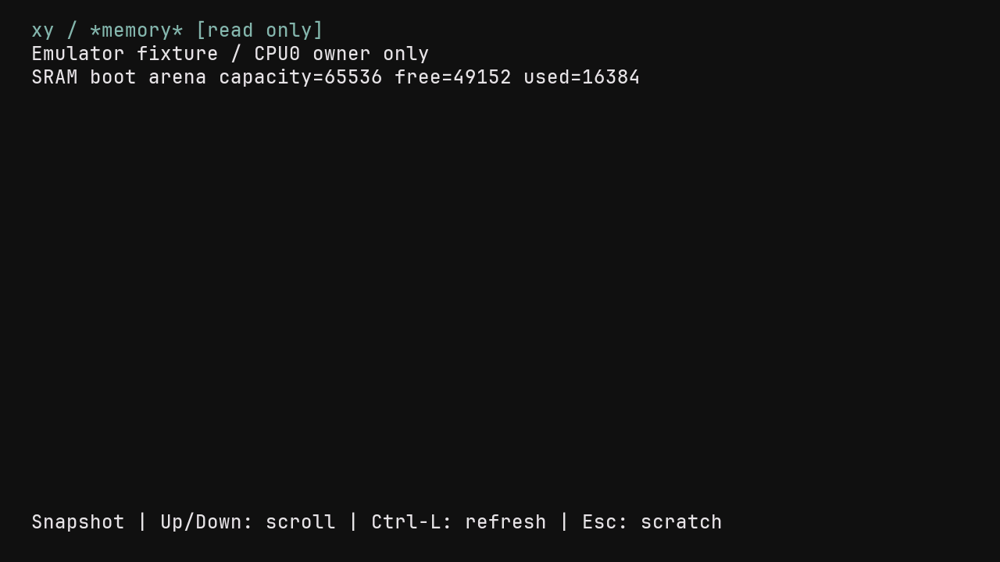

# Read-only system buffers inside xy

The normal xy workspace can open retained boot logs, owner-local memory usage
and published runtime counters without entering the legacy shell. From scratch,
press Esc, enter `log`, `mem` or `tasks`, then Enter. Each opens a compact
`*log*`, `*memory*` or `*tasks*` view marked `[read only]`. Up/Down scroll,
Ctrl-L captures again and resets scrolling, and Esc/Ctrl-C returns to scratch.

The original shared Document, byte cursor, revision and undo history remain
untouched. Text, Backspace, Delete and undo keys in a system view cannot edit
scratch. The host test also covers UTF-8 input and direct insert attempts in
that state. Returning restores the same document viewport, and the last edit
remains undoable. This is a transitional typed command controller; a full
Scheme VM and Scheme command registry are still unconnected.

A single allocation-free snapshot stores up to 4,096 printable diagnostic
bytes. Control bytes cannot execute terminal escapes; truncation and older
boot-log loss are indicated. It borrows the existing display PSRAM tail with
compile-time bounds, before networking state. It does not reserve another
primary heap. Refresh is explicit, so a changing diagnostic stream cannot
move the text while it is being read.

`log` copies the two chronological retained journal spans and the dropped-byte
indicator. `mem` reports CPU0 owner-local SRAM arena and reusable PSRAM usage;
it explicitly excludes stacks/display and does not claim system-wide free
memory. `tasks` reports two harts' published tick/switch/call counters, observed
per field; it is not an atomic task listing or application scheduler UI.
Boot/fault logging remains independent of xy.

## Integration and resource gate

This branch starts from main `980f522` and reapplies the previous xy startup
commits before adding system buffers. Concurrent primary-checkout Scheme work
is excluded. The previous startup report's physical evidence still describes
its original candidate, not this integrated image.

The initial integrated link fell below the unchanged 49,152-byte SRAM heap
floor. A private, unqualified size-only diagnostic found a 49,088-byte heap;
that diagnostic ELF was never installed or accepted by the product audit.
The product linker and threshold are unchanged. Foreground session rendering
and snapshot capture now occupy the existing device Flash text section, with
only their exact entry points added to the independent image allowlist.
Read-only help/report text uses the existing display Flash data section. The
portable snapshot renderer is inlined into its caller's chosen section.

| Final candidate | Primary heap bytes | Required floor |
| --- | ---: | ---: |
| Normal xy device | 49,472 | 49,152 |
| Synthetic-state trace | 49,216 | 49,152 |

The fixed display reservation remains unchanged. The remaining SRAM headroom
is small; no Scheme VM capacity or integrated stack high-water qualification
is implied. Trace builds expose snapshot kind, byte count and hash in addition
to scratch state; they do not emit document or snapshot text.

## Verification

- Focused console/Document/scratch tests: 41 passed in ReleaseSmall.
- ReleaseSafe root tests: all 61 build/test steps passed, including cached
  artifacts; executed test counts are not added across runs.
- The complete static-analysis entry point passes on the updated main base,
  including formatting, zlint, shellcheck, broker/checkpoint checks, RV32 owner
  codegen and six audited native links. Earlier baseline lint errors from the
  startup branch have been fixed independently on main.
- The explicit legacy startup opt-out also builds and passes its image audit.
- Both final normal and trace device images pass the native image audit;
  source manifests match the checked-out inputs.
- ESP-EMU executes the shared RV32 model/input/grid/raster. Diagnostic data is
  explicitly deterministic fixture data, not a native memory/task observation.
  Every system view preserves scratch text/cursor, rejects editing, refreshes
  and returns to the exact previous framebuffer hash. Log scrolling reaches
  a stable clamped end, refresh restores its first page, and scratch undo still
  works after all three views. Frame guards remain intact.

The bounded physical attempt did not start because another owner held the
shared board lease. Its receipt has `installed=false`, no observations and
`passed=false`; this candidate is not physically qualified.

Physical qualification status and exact image/source identities are retained
in the [evidence index](evidence/2026-10-31-xy-system-buffers/evidence-index.json).
No optical comparison, physical HID, cold-power, persistence, Japanese raster
or Scheme execution claim follows from these checks.

```sh
zig build test -Doptimize=ReleaseSafe --summary all
sh tools/run-static-analysis.sh
python3 tools/run-xy-scratch-smoke.py
sh tools/build-native.sh device integer
NIHOS_NATIVE_XY_TRACE=1 sh tools/build-native.sh device integer
```

The bounded physical tool extends the original startup phases with open,
read-only input, refresh and return for all three system buffers. It requires
exclusive board ownership and source/image identity checks before any writes.


