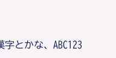
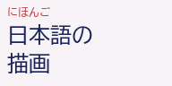
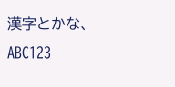
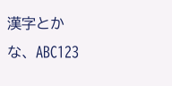

# Native graphics qualification

Status: local ESP32-P4 emulator execution and both revision-profile image
audits passed, 2026-10-28. Physical Tab5 qualification remains pending.

The opt-in `graphics` image executes real kernel boot, PSRAM preparation,
SMP/lifecycle/IPI fixtures, native task dispatch and timer handling before
running FreeType/HarfBuzz on a dedicated CPU0 task. Timer events come from
the emulated P4 peripheral rather than a host instruction hook. This remains
emulator evidence, not physical timing or visible display evidence. The
fixture hashes glyph IDs, advances and raster pixels; it does not present a
framebuffer. A bounded cluster-flow primitive places wrapped runs, with a basic
Japanese prohibition map now constraining breaks. Full paragraph/ruby layout
remains pending.

## Run

```sh
NIHOS_GRAPHICS_RV32_CXX=/path/to/riscv32-esp-elf-g++ \
  sh tools/run-native-graphics-smoke.sh
```

The existing pinned ESP-IDF loader toolchain is required. Device-profile
structural qualification, without accessing hardware, is:

```sh
NIHOS_GRAPHICS_RV32_CXX=/path/to/riscv32-esp-elf-g++ \
  sh tools/build-native.sh device graphics
```

UART stdout is retained as `case-32M/emulator.log`; emulator diagnostics go to
`emulator-stderr.log`. Both files are digest-bound in the smoke receipt, so host
diagnostics cannot split a firmware pass record. No transcript filtering is used.

Neither command opens a serial port or flashes hardware. Normal integer,
floating, compiled and SQLite configurations retain their partition/layout
contracts. This separate fixture uses its own loader directory and a **12 MiB
factory partition** because it temporarily embeds full pinned BIZ UD Gothic
and Mincho inputs. Production fonts are still intended for filesystem loading.
The unmodified fonts' OFL notices, FreeType FTL and HarfBuzz COPYING remain
with the pinned sources and must accompany a separately distributed bundle.

## Placement and C runtime

The generated, digest-bound `graphics_payload.o` function manifest controls
font-library execution in the Flash span starting at `0x40020000`. Read-only
tables and font inputs follow. A separate RX span after the fonts now contains
exactly `native_surface.paint` and `native_surface.draw`. The SRAM wrapper owns
context checks, allocation, guards and release. Kernel control, task/interrupt
and allocator code stay in primary SRAM. All defined library/libc/compiler-helper globals except the
four fixture entry/result/PC/output symbols are renamed into a private namespace.
This prevents a library helper from silently redirecting a kernel call into
Flash. FreeType's default file/memory entry points remain unsupported;
callbacks and explicit ownership are mandatory. Dynamic initializers and TLS
are rejected by the image auditor.

The first image left an alignment gap between library constants and fonts.
It produced three mapped segments and the stock loader rejected it with
`rom_index < 2`. Explicit zero padding now makes records, library code/RO and
fonts one contiguous second mapping; descriptor/boot code is the first.
Audits compare every mapped byte with the ELF and verify both TTF SHA-256
values. The failed image and log are retained separately.

Source preparation also has a cross-process lock and a content witness. Once
prepared, subsequent builds verify and reuse the source tree without restoring
archives or reapplying patches under a compiler. Changed dependencies or a
modified cache fail explicitly; prepare a fresh generated source cache between
builds. Two concurrent preparers must return only the same source path, keep
all file modification times unchanged and retain the local OOM patch.

| Internal SRAM region | Reserved bytes | Purpose |
| --- | ---: | --- |
| Existing primary region | 163,840 | Kernel/static data and ordinary heap |
| Existing stack bank | 57,344 | Bootstrap, IRQ and original worker stacks |
| `0x4ff6e000..0x4ff76000` | 32,768 | One font task stack |
| `0x4ff78000..0x4ff80000` | 32,768 | Private library writable data/controller |

Both extra regions are checked against the actual loader's allocations and
the pinned SDK's revision-specific SRAM/cache windows. The loader copies
graphics initialized data; native CRT explicitly clears its BSS. Bootstrap
paints and guards the font stack before admission. The existing 56 KiB stack
bank is unchanged. All 64 KiB of extra reservations are counted as fixed SRAM,
including unused library-region capacity. Two clients share those regions.

| Measure | Emulator profile | Device profile, build only |
| --- | ---: | ---: |
| Primary static span | 111,104 B | 111,360 B |
| Remaining primary SRAM heap | 52,736 B | 52,480 B |
| Static reservations including stack/data regions | 233,984 B | 234,240 B |
| Application image | 11,576,048 B | 11,577,504 B |

Font-library code/RO occupy 561,072 B in Flash; the separate renderer adds
2,816 B of RX code. TTF inputs occupy 10,821,312 B,
plus 16 B alignment in their section; they account for most of the image.
Private initialized data/BSS occupy 20,764 B within the 32 KiB region. These
figures exclude document models, display buffers, native font-filesystem
caches and application routing. The two fixed transport queues reserve
3,200 B in primary SRAM, including tokens/metadata but no bitmap bytes.
Surface composition added 1,920 B to primary static relative to the
raster-only fixture. Bounded cluster flow adds another 256 B net, after moving
the diagnostic glyph archive to demand-allocated PSRAM. The basic prohibition
pass adds another 896 B net while sharing placement/drawing paths and moving
immutable boundary maps to the existing mapped Flash display-data span. The
private packet grows from 776 to 844 B;
no further stack or library SRAM region is reserved. Raster storage is demand
PSRAM, separately accounted below.

## Ownership and execution

The font task uses a real scheduler generation/slot identity. Its backing
adapter obtains bounded, noncontiguous extents from the **already initialized**
native CPU0 PSRAM heap; it cannot initialize or replace that heap. Canonical
child handles stay in the task ledger. Root/extent changes are bounded and
locally IRQ-masked; library work and source copies execute with MIE enabled.
Other native profiles retain zero extent-group slots.

The matrix fixture runs two open sessions, four body sizes with half-size ruby runs
and horizontal/vertical shaping: 16 cases with forced auto-hint per cycle.
It runs four open/draw/close cycles for both clients on the same live task,
for 64 cases in total, followed by five text jobs. A text job opens only its
selected font. The service returns through the actual task ABI after stop.
Native EXIT closes the ledger; bootstrap drains one extent per cleanup step,
reaps only after cleanup and checks complete heap recovery.

The initial [single-cycle receipt](measurements/2026-10-28-native-graphics.json)
records the first native integration. The
[client-cycle receipt](measurements/2026-10-28-native-graphics-client-cycles.json)
records the earlier active-idle experiment. The
[request/wait receipt](measurements/2026-10-28-native-font-request-wait.json)
records the first queued matrix endpoint. The
[text-request receipt](measurements/2026-10-28-native-font-text-requests.json)
adds owned UTF-8 inputs. The
[glyph-metadata receipt](measurements/2026-10-28-native-font-glyph-metadata.json)
records copied metrics. The
[raster-lease receipt](measurements/2026-10-28-native-font-raster-leases.json)
adds borrowed pixels. The
[surface-composition receipt](measurements/2026-10-28-native-surface-composition.json)
adds a shared RGB565 consumer on that live task. The
[cluster-flow receipt](measurements/2026-10-28-native-cluster-wrap.json) extends
that consumer with bounded horizontal/vertical wrapping and archive retirement.
The [basic-prohibition receipt](measurements/2026-10-28-native-kinsoku.json) adds
source-boundary policy and a third composition pass. The
[render-placement receipt](measurements/2026-10-28-native-render-placement.json)
then moves the task-only paint/draw code to Flash. The current run records:

- All 64 cases repeat the same 16-hash matrix, which also matches the
  sanitized host reference. An `auipc` sample inside the C++ entry confirms
  execution in the whitelisted library function.
- The timer captures the font task 6,410 times, including 6,393 during
  shaping/rasterization stages; bootstrap advances 12,620 times.
  Ten request waits span twenty real scheduler ticks in total, with zero
  additional font-task runtime while blocked.
- Stack watermark/frame observation reaches 17,264 B, leaving 15,488 B above
  that observation and the 16 B guard in a 32 KiB reservation. This is not a
  worst-case or native IO call-chain bound.
- Font-span backing for two clients peaks at 1,310,976 B; raster charge is
  accounted separately. Closing clients
  leaves 65,792 B of HarfBuzz backing; task-ledger retirement then restores
  16,018,752 B while the diagnostic archive remains live. Freeing that archive
  after logging restores CPU0's original 16,022,848 B.
- Other-task/dispatch operations are rejected; the owning task also rejects
  an invalid address without changing free heap. The 1,024-record controller
  peaks at 694 records.

## Client and service lifetimes

Closing the last client frees its face and source-cache extents, while
service-owned HarfBuzz state remains in one backing extent. Every cycle must
leave exactly the same retained charge and matching native free-heap balance.
The next job reuses that live service state without another backing init,
task admission or stack paint. Each matrix must match the first matrix and
the independent host reference. Text replies must match a separate sanitized
host execution using identical input bytes and settings.

With zero clients, the font task receives the next request through a bounded
channel. Empty receives block in the scheduler; there is no active idle loop
inside the font worker. Bootstrap deliberately holds each request for two
real ticks and verifies unchanged worker runtime. This is font-task blocking,
not whole-system WFI or a physical power/timing measurement.

The [request-boundary decision](adr/0044-native-font-request-waits.md) specifies
two two-slot SPSC queues, copied IDs/results and one client dispatcher. Four
matrix requests produce 64 cases, followed by five bounded text requests and
an ordered stop request. The terminal reply must be copied and its space notification completed before an
independent acknowledgment permits worker EXIT. A task yield is forced between
releasing that reply slot and notifying the worker to exercise this lifetime
window. All ten replies, acknowledgments and empty queues are required.

The [owned-text decision](adr/0045-owned-font-text-requests.md) adds body and
optional ruby arrays copied inline into the queue: 128 and 64 UTF-8 bytes.
Requests specify font, body size, direction and hinting. The producer poisons
its original bytes/settings before waking the worker; all five text replies
still match independently executed host output.
A deliberately missing U+10FFFF glyph and a 17-glyph output overflow publish
zero runs/hash/glyphs with distinct typed failures, after which two other text
requests succeed. Body/ruby runs are shaped and rasterized independently; this is not ruby placement or layout.

The [owned-glyph decision](adr/0046-owned-glyph-metadata.md) adds up to 16
copied glyph records. Glyph IDs, byte clusters, run tags, ppem, signed advances/
offsets, bitmap bearings and dimensions match the
[host glyph reference](measurements/2026-10-28-font-glyph-host.json) for all 33
successful glyphs. After publication the worker poisons its reusable packet;
consumer snapshots remain valid after library close and task retirement.
The [A8 lease decision](adr/0047-borrowed-a8-raster-leases.md) now supplies
actual pixel bytes through an owner/token-checked const view. Each successful
request retains its tightly packed A8 prefix across two real ticks, reconstructs
the original draw digest, then retires and releases it through a control
message. Three rasters contain 9,773 bytes in total. Each logical 16 KiB buffer
charges 32 KiB of actual task-owned PSRAM; all three releases and two failure
discards restore raster charge to zero. Eight stale/retired-token lookups and
three foreign frees are rejected. A read view must never be kept after retire.
Only one raster may be outstanding in this fixture.

The [host raster reference](measurements/2026-10-28-font-raster-host.json)
records the same pixel digests and offsets. The following host atlas arranges
individual glyph masks in cells, with successful requests 5, 8 and 9 as rows;
it does not apply paragraph/ruby placement or present on a native display.


Multiple applications still need a broker or distinct client channels;
concurrent producers, cancellation and service restart remain unqualified.

The [shared surface decision](adr/0048-borrowed-rgb565-surfaces.md) defines an
allocation-free RGB565LE/A8 API with signed placement, clipping, alpha blending,
non-aliasing and preserved row padding. The native consumer composites all 33
glyphs into three temporary offscreen surfaces **before** releasing raster
leases. Five glyphs intersect or fall outside the viewport. Three guard/padding
checks and six invalid-operation rejections pass without modifying results.

Each guarded canvas logically occupies 38,464 B and charges 65,536 B of
consumer-owned PSRAM; all canvas charge returns to zero before raster release.
These costs are separate from font backing and the raster lease. The device
profile now retains 52,480 B of primary heap, above the unchanged 48 KiB floor.
The first link hit that floor; reducing duplicate diagnostic archives recovered
space without changing queued replies or disabling compiler safety checks.

The [independent reference](measurements/2026-10-28-surface-reference.json)
uses per-source-pixel clipping and matches the native padded RGB565 digests.
These PNGs are reference visualizations with fixed test origins, not native
LCD captures or a paragraph/ruby layout implementation:




The [bounded cluster-flow decision](adr/0049-bounded-cluster-flow.md) adds an
allocation-free 26.6 cursor and an adapter grouping equal shaping clusters.
A group moves intact to the next line/column. Capacity/advance errors preserve
the cursor; unsupported cluster order and cross-axis advances are rejected.
The native second pass reuses the same canvas before releasing the raster.
Horizontal bodies wrap at 96 px; the vertical body wraps at 64 px into columns
moving right to left. Three frames contain 33 clusters, nine occupied lines/
columns and four transitions, with no clipped glyphs. Independent batch
reference digests match the complete native padded buffers:





These are host reference previews, not LCD captures. The native cases each have
one glyph per shaping cluster; host tests also cover multiple glyphs sharing a
cluster. This greedy policy does not implement kinsoku, word segmentation,
bidi, contextual reshaping at breaks or paragraph pagination. The independently
placed ruby run does not yet follow the wrapped body or identify its base.

The complete diagnostic archive now allocates 2,736 B in bootstrap-owned PSRAM
(2,496 B glyphs plus 240 B snapshots/hashes, actual buddy charge 4,096 B),
retains copied results through worker retirement, and frees after logging. The
accessor exposes only the initialized prefix and returns an empty slice after
free. This archive plus the temporary canvas fit the bootstrap's existing two-root quota.
Its final free restores the original CPU0 heap; it is separate from the
font-task heap baseline and is not a persistent font-service allocation.

The [basic Japanese break policy](adr/0050-basic-japanese-break-policy.md)
separates UTF-8 scalar boundaries from shaping and placement. It joins whole
clusters across prohibited boundaries before the flow cursor places them.
The supported opening/closing brackets, punctuation, small kana and related
marks are explicitly listed in the source. This is a basic subset, not full
JLREQ/JIS/UAX14 conformance, western word breaking or hanging punctuation.
Overlong indivisible spans fail explicitly without consuming the cursor.

A third native pass uses the same guarded canvas and retained A8 raster. At an
80 px horizontal width, `な、` moves together to avoid a line starting with the
comma. In the vertical continuation case, `く。` moves together to avoid a column
starting with the full stop. The first column has an already occupied 32 px
prefix, deliberately exercising continuation rather than a fresh paragraph.
The independent ruby run also joins its small kana. Three native frame digests
match [the independent reference](measurements/2026-10-28-kinsoku-reference.json):
30 spans, three joined boundaries, ten occupied lines/columns and five transitions,
with no clipped glyphs. Host controls with the same geometry and policy disabled
expose two prohibited starts; an additional host case tests an opening bracket
at line end. The pinned native cases do not test that opening-bracket behavior.




These are host reference images, not LCD captures. Source-map construction for
arbitrary UTF-8 is host-tested. The native fixture uses maps prepared at build
time from canonical inputs, placed in the existing mapped Flash display-data
span; its real-time source-map preparation and IO path remain unqualified.
That prohibition-only device build reached the unchanged 48 KiB primary heap
floor. The following placement change recovers headroom without reducing it.

The [task-only Flash rendering decision](adr/0051-task-only-flash-rendering.md)
separates the SRAM ownership wrapper from two borrowed-buffer rendering functions.
A distinct `.flash.graphrender` RX/non-writable span follows the pinned fonts in
the same second loader mapping. The auditor accepts exactly `native_surface.paint`
and `native_surface.draw` there, with contiguous function extents, and requires
the wrapper, context check, timer hook, trap, dispatcher and task alloc/free
helpers to remain SRAM functions. The assembly trap now has explicit ELF
function/size metadata so its complete extent can be audited. Source-level
context/return ABI and stack/heap reservations are unchanged.

The two Flash functions occupy 2,816 B. Outlining and the resulting code/alignment
changes recover 3,328 B of primary SRAM on both revision profiles, including
post-paint bootstrap/IRQ stack-guard checks. Device primary heap grows from
49,152 to 52,480 B (51.25 KiB), leaving 3.25 KiB above the retained 48 KiB floor.
App image size falls by 528 B
for both profiles; no PSRAM allocation, quota or fixed SRAM region is enlarged.

Before and after paint, the SRAM wrapper requires the CPU0 bootstrap consumer's
active task identity and MIE enabled. After each paint it also verifies the
bootstrap and IRQ stack guards. A separate timer hook rejects entry with
MIE clear using only internal state; it reads no borrowed pixels or Flash table.
The native receipt records in-range paint/draw PC samples and timer captures
inside the rendering Flash span (four Flash PC captures across six active-call
timer captures, with 7,336 IRQ entry rejections), followed by unchanged matrix/
raster/all three
composition-pass hashes and complete final heap recovery. These finite guards
and observations do not prove a general call graph or privilege boundary.

The call requires active Flash mappings/caches. This fixture has no runtime
Flash-write/cache-off phase. Physical behavior and a production update/render
exclusion protocol remain unqualified; this change does not permit rendering
while its mapping is unavailable. Fixed font stack/library SRAM remains reserved
while idle. This stage changes placement rather than adding ruby association.

Retirement ends this library lifetime. HarfBuzz globals would refer to retired
backing afterwards, so the fixture refuses another admission and never calls
the libraries again. It is **not** an application-ready font service, restartable
library lifetime or general client cancellation. Production integration must
retain service-owned state across client closes and define safe shutdown/restart
separately.

## Remaining integration

Flash input is a qualification mechanism, not production storage. Native SD
currently has a boot-only controller/clock lifetime. A font read-at provider
needs persistent ownership, task-safe clock/waits, large-file handles, source
revision/removal handling and failure without publishing partial output.
The boot-only littlefs fixture's 64 KiB file/read-count limits cannot be reused
for these multi-megabyte TTFs.

Physical cache/PSRAM/SMP/stack behavior, display output, SD input, removal,
storage-induced latency and repeated service startup remain unqualified.
No hardware was accessed or firmware published in this stage.
