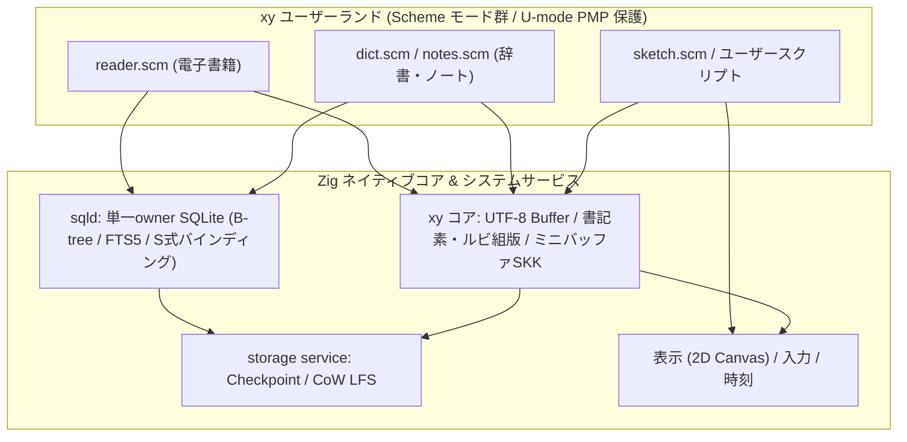

# nihosを学習と制作に使うためのアプリケーション構成案

2026年10月25日（2026年10月30日改訂）。アプリ実装前の設計検討。データ容量の根拠は[今回のhost測定](../measurements/2026-10-25-learning-data-host.md)に分離する。

nihosは「読める、調べられる、書ける、書いたプログラムを動かせる」小さな学習・制作端末（HackerのためのConvivial Machine）を目指すとよい。クラウド常時接続を前提にするIoT端末や、POSIX風shellと個別Cアプリを並べる構成とは一線を画し、当面は独立したshellを持たず、起動直後から統合環境 `xy` が立ち上がる専用機として設計する。エディタ、書籍、辞書を別々のバイナリに分断せず、読書中に語を引き、引用とメモを残し、自分のプログラムで計算や図示・道具の改造を行うところまでを、`xy` 上のバッファとS式評価でつなげる。Quakeは負荷と性能の評価に使い、日常の有用性はこの一連の操作で作る。

子ども向けの正面の言語は、エディタ拡張の言語と分けて選ぶ選択肢を残しつつ、まずは `xy` 自身の拡張とユーザーランドアプリ（電子書籍リーダー、辞書、学習ノート等）をSchemeで統一的に記述する経路を先行させる。[処理系の比較](learning-languages.md)では、制作APIを持つMicroPython＋ulabを第一候補に、Lua/Luauを制作向けの対抗案としている。エディタ拡張についても[SchemeとLuaの比較](editor-extension-language.md)を行い、Unicode編集は共通coreが担う構成にする。

## 最初に用意したい道具（`xy` 上のモードとして統合）

独立したshellや個別のネイティブアプリ群を作る代わりに、以下の道具はすべて `xy` の共通バッファ・ミニバッファとSchemeモードの組み合わせとして成立させる。

| 道具 | 日常の用途 | 最初に成立させる操作 | 実装の層 |
| --- | --- | --- | --- |
| `xy` エディタとバッファ/ファイル管理 | コード、メモ、短い文章を書く、環境全体を操作する | 日本語入力（ミニバッファ型SKK）、検索、undo、LFS/SQLiteによる保存と復旧、最近使った項目 | Zig core ＋ Scheme (`editor.scm`) |
| 電子書籍・青空文庫ビューア | オフラインで本や教材を読む | ルビ、目次、読書位置（しおりのSQLite保存）、語の選択、辞書を引く、引用をメモへ送る | Zig layout/buffer ＋ Scheme (`reader.scm`) |
| 辞書 | 日英・英日、漢字、専門用語を調べる | 見出し・読み・前方一致、語義、リンク、履歴、単語帳へ登録 | `sqld` (B-tree/FTS5) ＋ Scheme (`dict.scm`) |
| 学習ノート | 読んだ内容や調べた語を整理する | 出典つき引用、タグ、全文検索、簡単な復習カード | `sqld` ＋ LFS ＋ Scheme (`notes.scm`) |
| プログラミングと数理ノート | 絵・音・ゲームの制作、計算、グラフ、道具自身の改造 | 選択範囲のS式/スクリプトを評価（`C-x C-e`）、2D Canvas描画、エラー位置へ移動、中断、結果を文書へ挿入 | U-mode PMP VM ＋ Scheme / 制作言語 |
| システム実験室 | OS本の実験、性能と資源の観察 | タスク、メモリ、I/O待ち、フレーム時間、検索時間の記録 | Zig metrics ＋ Scheme (`lab.scm`) |

計算機とグラフは数理ノートの使い方として提供する案がある。簡単なゲーム、タートル描画、ライフゲームも、利用者がプログラムを変えて結果を見る教材として位置づけられる。最初から全てを独立したネイティブアプリに分割する必要はない。

## 共通の基盤（Zigの機構とSchemeの振る舞いの分離）

文書・文字組・ピクセル描画・永続I/OのようなメモリとCPUを食う「機構（Mechanism）」はZigのネイティブコアとsystem serviceに置き、画面遷移・キー割当・クエリ組み立て・しおりや引用のワークフローといった「振る舞い（Policy / アプリ機能）」はScheme側に置く。カーネルへ文書形式やSchemeの意味論を埋め込まず、カーネルとsystem serviceが表示、入力、時刻、保存、検索、U-mode PMPで隔離された実行の資源境界を提供する。

電子書籍リーダーも別バイナリにはせず、`sqld` から章・セクション単位で本文とルビ属性スパンを取得して `xy` のread-onlyバッファに流し込むSchemeモードとして実装する。これにより全文をSchemeヒープへ展開せずに32 MiB機で長編を扱え、かつ読書中の辞書引き・引用保存・リーダー自身の改造がすべて同じS式環境で完結する。

日本語IME（SKK）も独立タスクや巨大な画面退避スナップショットを持たず、`xy` のバッファ内preedit overlayとミニバッファ候補表示として組み込み、辞書検索と学習履歴の永続化には `sqld` とLFSの基盤をそのまま再利用する。

[ADR 0002](../adr/0002-smp-services.md)の通り、SQLiteは単一owner taskが直列に呼び出す。CPU1への永久固定は前提にしない。描画や音声の期限を優先し、検索は件数、時間、結果バッファを制限し、中断可能な仕事として扱う。

最初は一接続をownerが管理し、読み取り専用の学習パックと書込み可能な学習記録を必要に応じて扱う。ATTACHを使うなら接続元のアプリにパスを渡させず、許可したパックIDから解決する。page cacheはDBごとに増え得るため、schema単位のcache設定とSQLite全体のheap制限を両方設ける。接続数を増やすのは実測後にする。

接続・権限・journal・取消・commit結果・検証段階の詳細は[SQLite integration](sqlite-integration.md)に定める。
複数の書込みDBをまたぐtransactionは初期対象にせず、一つの個人DBへの更新で完結させる。

ネイティブの組込みアプリと、利用者が書くLua、Python、JavaScriptやWasmのプログラムは、同じ表示・保存・検索APIを使える構成を目指す。Wasmに生ポインタやSDパスを渡さず、世代つきhandle、範囲つき文字列、上限のあるrow batchを使う。

## エディタを実用にする条件

一つのUTF-8編集エンジンを、コードと文章の両方に使う。最初の対象は64〜256 KiB程度の編集文書とし、上限のあるundo履歴を持つ。大きな書籍は編集バッファへ全ロードせず、ビューアで部分読み込みする。文書上限とundo容量は設計値であり、現在のnihosで実測した値ではない。

実用性を左右するのは、多言語対応を最後に加える進め方を避けることである。UTF-8の境界、結合濁点を含むカーソル移動、選択、行折返し、全角・半角、IME変換中の表示を初期から扱う。物理キーボードとtouchのどちらからも保存・検索・実行中断へ到達できるようにする。

保存では、既存ファイルを途中まで上書きして終わらせない。storage serviceによる置換と復旧の契約を使い、原稿、バックアップ、編集中の状態を区別する。これは[architecture](../architecture.md)のストレージ実装と故障試験に依存する。

[VFSの保存契約](filesystem-vfs.md)に従い、実行時の置換と電断後の回復を区別する。
FAT/exFATで既存fileを削除してからrenameする手順を安全な置換保存として使わない。
保証未対応のmountでは強い保存要求を明示的に拒否し、保存完了前の原稿を編集bufferから捨てない。

外部エディタを丸ごと移植するより、nihos向けの小さなUIに編集部品を組み込む案が有力である。[stb_textedit](https://github.com/nothings/stb/blob/master/stb_textedit.h)は編集操作・undo部品の候補だが、日本語IME、表示、ファイル管理を提供する完成アプリではない。独立した小さなgap bufferとの比較を先に行いたい。シンタックス色分けは簡単な字句解析から始め、LSPや大きな構文木の常駐は必要性が出てから評価する。

## 端末内プログラミングの段階

「セルフ開発」は、利用者のプログラムを端末内で作ること、コンパイラ自身を端末内で作り直すこと、OS全体を再ビルドすることに分ける。最初の価値は、ネットワークやPCなしでコードを書いて試せることである。

| 段階 | できること | 選択肢と残る仕事 |
| --- | --- | --- |
| Scriptを評価する | 制作、計算、図示、教材 | 選んだ処理系の移植、メモリ上限、中断、APIとエラー位置の接続 |
| 作った処理を保存する | 自分の道具を端末内で編集・再利用 | ソース・素材・依存ライブラリの管理、版とデータの互換性 |
| Scheme等からWasmを作る | 独立したモジュールとして配布・実行する発展教材 | 対応する言語機能、ランタイムABI、バイナリ出力、ソース位置情報 |
| コンパイラを作り直す | 教育用コンパイラの自己拡張 | stage比較、メモリとGC、bootstrapの固定 |
| ZigやOSを再ビルドする | nativeアプリ・カーネルまで再構築 | コンパイラの実行環境、メモリ、リンカ、libc/OS APIの大きな移植 |

### エディタ拡張と発展教材向けのScheme候補

以下はSchemeを選ぶ場合の候補であり、子ども向けの標準言語をSchemeに固定するものではない。正面の制作・数理環境の比較は[別の検討](learning-languages.md)にまとめる。

| 候補 | 適性 | 注意する境界 |
| --- | --- | --- |
| [Chibi-Scheme](https://github.com/ashinn/chibi-scheme) | C組込み向け、Unicode、R7RS-smallを持ち、エディタとREPLの候補になる | 標準ライブラリを絞り、割当・I/O・実行中断をnihosへ接続する。Wasmへのコンパイラではない |
| [Ribbit](https://github.com/udem-dlteam/ribbit) | 小さなVMとScheme製コンパイラを読み、拡張する教材に向く。WAT targetもある | 小さい配布サイズはピークRAMの保証ではない。VMとbytecodeの経路、WATのバイナリ化、nihos I/Oとの接続を調べる |
| [Guile Hoot](https://spritely.institute/hoot/) | SchemeからWasmを生成する実例で、R7RS-smallを目指す本格的な候補 | GuileとWasm GC・tail calls・stringrefなどを含む実行環境の適合確認が必要。最初の小さな組込み処理系としての移植は重い |
| [Schism](https://github.com/google/schism) | Scheme製の自己ホストWasmコンパイラの設計参考になる | READMEには古い実験的機能とJS runtimeへの依存が残る。完成した端末用処理系として即採用しない |

ChibiとRibbitのライセンスはそれぞれ[ChibiのCOPYING](https://github.com/ashinn/chibi-scheme/blob/master/COPYING)、[RibbitのBSD-3-Clause](https://github.com/udem-dlteam/ribbit/blob/main/LICENSE)で確認できる。採用候補を数百行の独自Schemeと比較するときは、Unicode、数値、macro、GC、エラー処理、長期保守も比較したい。

Hootの必要機能は[公式Status](https://files.spritely.institute/docs/guile-hoot/latest/Status.html)で説明されている。一方、[WAMRの現在のbuild設定](https://github.com/wasm-micro-runtime/wasm-micro-runtime/blob/main/doc/build_wamr.md)にもGC、stringref、tail callsの選択肢があるため、「組込みWasmではGCが一切使えない」とは決めつけない。ただし有効化だけでHootが動くとは限らず、GC実装の既知の制約、host imports、RV32上の構成、必要RAMを実際のプログラムで確かめる必要がある。

エディタ拡張のSchemeを選ぶ段階ではChibiとRibbitを比較する。SchemeからWasmを出す経路は、Ribbitの既存経路を試す案と、対応範囲を明示した小さなコンパイラを教材として作る案を比較する。後者は数値、条件分岐、局所変数、関数、繰返しから始め、closure、可変長引数、継続、GCを段階的に扱う。全Scheme互換と呼ばない。

Scheme処理系をCからWasmへコンパイルし、その中でSchemeソースを解釈する方式もある。この場合に生成したWasmは処理系であり、利用者のSchemeをWasm命令へ変換したことにはならない。この違いは書籍でも説明する価値がある。

### Zigを端末で動かす可否

PC上でZigからnihos用のnativeコードやWasmを生成する経路は有力である。今回、固定版Zig 0.17.0で小さな関数をWasmへ生成し、NodeのWebAssemblyで結果を確認した。

Zigコンパイラ自体をnihos上で動かすことは別の移植である。[公式platform support](https://ziglang.org/learn/platform-support/)も、プログラムの生成先と、コンパイラ自身の実行先を区別している。手元の配布コンパイラは約190 MiBで、hostの空cacheから小さなWasm関数をコンパイルしたときの最大RSSは約278 MiBだった。`-fno-llvm`でもこの条件のRSSは小さくならなかった。これはmacOS版の観測であり、最小化したRV32版の下限値ではないが、32 MiB機へそのまま持ち込む根拠にはならない。

したがって初期の「端末だけで作れる」体験はMicroPythonやLuaなどの組込み処理系で成立させたい。ZigはPCでのクロス開発を正式な経路にし、端末にはソース編集と診断表示を用意する。小さくしたZigコンパイラのnative移植や、コンパイラのWasm化は、別の研究課題としてメモリ・OS API・リンカを含めて評価する。

## SQLiteとFTS5で支えるデータ

32 MiBというRAM容量から、辞書を32 MiB以下へ縮める必要があるとは限らない。SD上のDBへ必要なページだけアクセスする。制約はSQLiteのcacheと作業heap、結果サイズ、SDのランダムI/O、キャンセルまでの時間に分かれる。[SQLite cache設定](https://sqlite.org/pragma.html#pragma_cache_size)はcacheの目安であり、SQL実行全体のRAM上限にはならない。

今回の測定では、JMdictの全218,957項目から見出し・読み・英語語釈を投影し、見出し用B-treeとFTS5を作った。語義ごとの適用条件、品詞、相互参照、頻度などは含まないため、配布用の完成辞書ではない。

| データ | 対象量 | B-treeを含む基礎DB | trigram・位置情報あり | trigram・位置情報省略 |
| --- | --- | ---: | ---: | ---: |
| JMdict英語版の簡易投影 | 218,957項目 | 48.49 MiB | 101.97 MiB | 65.68 MiB |
| KANJIDIC2の簡易投影 | 13,108字 | 2.84 MiB | 4.86 MiB | 3.36 MiB |
| 青空文庫の3作品 | UTF-8本文1.72 MiB、597区画 | 2.34 MiB | 6.73 MiB | 4.09 MiB |

青空文庫の対象は『吾輩は猫である』『こころ』『銀河鉄道の夜』。一作品を一つの巨大なFTS行にせず、今回の試算では1024文字単位に分割した。正式なパックでは段落・見出しと対応づけ、原文の安定した位置へ戻れるようにする。

各DBについて、mmapを無効にし、page cacheの目安を1 MiB、SQLite allocatorのhard heap limitを4 MiBにした別プロセスで、指定した読取りクエリが成功した。これはPythonやUIを含む全体メモリが4 MiBという意味でも、全てのクエリが収まるという意味でもない。実機のSD遅延やページcacheの効き方は未測定である。

### 最初の容量目標

内蔵16 MiB Flashにはカーネル、最低限の道具、復旧用の小さなデータを置き、大きな辞書、フォント、書籍、利用者の作品はSDへ置く。現在のbootstrapは1 MiBのアプリpartitionを使っているため、16 MiB全体がそのままコード用に空いているわけではない。

初期の検索評価対象は、1パック256 MiB以下、全体1 GiB程度を目安にする。JMdict＋漢字辞書＋教材・書籍の選集には現実的な出発点になる。これは実装の保証上限ではなく、実機で測る対象の大きさである。数GiBへ進むときは、32-bitなファイルoffsetの混入、SDのFS、DBごとのcache増加、低速カード、更新時の空き領域を再検査する。

書籍1000点の容量は、一点の長さと索引で大きく変わる。仮にUTF-8本文の平均を100 KiBとすると本文は約97.7 MiBであり、今回の3作品の比率を仮に当てれば約230〜380 MiBのDBとなる。ただし長編3作品からの条件つき外挿であり、青空文庫全体の容量を測った結果ではない。まず対象コレクションを固定し、同じprobeで作り直す。

SQLite 3.54.1をRV32向けにコンパイルした今回のオブジェクト測定では、FTS5ありのGNU sizeのtext（コードと読み取り専用データ）は617,046 bytes、初期dataは6,240 bytesだった。VFS、RPC、C runtime、スタック、heapを含む最終firmwareではない。辞書より先に、アプリpartitionとフォント・IMEの配置を設計し直す必要がある。

### 日本語の検索方式

FTS5を入れるだけでは、日本語を期待通り検索できない。今回のprobeでも、標準trigramのMATCHで「日本」「辞書」は0件、「日本語」はヒットした。[公式trigramの説明](https://sqlite.org/fts5.html#the_trigram_tokenizer)に従い、次を分ける。

| 検索の目的 | 初期の方式 |
| --- | --- |
| 辞書の見出し・読みの完全一致と前方一致 | 正規化した文字列のB-tree。1〜2文字にも対応する |
| 英語語釈や英語文書 | unicode61の語単位FTS。日本語の形態素解析とは別である |
| 日本語本文の部分一致 | trigram。1〜2文字の扱いをUIと実装で別に決める |
| 日本語本文中の2文字検索を高速化 | bigram tokenizerまたは専用索引を追加評価する |
| 語の意味に沿った日本語検索 | PC側での形態素解析と、同じ規則のquery処理を評価する |

初期の辞書は見出し・読み検索と英語語釈検索を優先し、巨大な日本語索引を必須にしない。読書中の「猫」のような一文字検索は、現在読んでいる作品や章へ範囲を絞った走査を用意できる。全ライブラリのLIKE走査へ無条件に落とすと、待ち時間が大きくなり得る。

`detail=none` は省容量だが、位置を持つ検索やsnippet/highlightの利用に制約が出る。trigramでは3文字を超えるMATCH queryにも制約があり、実際に「日本語辞典」はエラーになった。省容量の部分一致索引ならLIKE/GLOB経路を使い、元の本文を読んで該当箇所を確認する構成を評価する。位置情報つきの全文検索が要るパックには`detail=full`を選ぶ。単なる設定値の切替として同じ検索仕様を約束しない。

FTS5のtokenizerを独自にする場合、パックのmanifestへtokenizer、Unicode正規化、辞書・モデルの版を記録する。PCで作った索引と端末のquery処理の規則を揃える。

## 辞書データの選択

OSSの辞書ソフトと、収録する辞書データの利用条件は別に扱う。まず次の組合せが有力である。

| データ | 役立つ場面 | 範囲と条件 |
| --- | --- | --- |
| [JMdict/EDICT](https://www.edrdg.org/pub/Nihongo/) | 日本語の語と読みから英語の意味を調べる、英語語釈から候補を探す | 日英・英日用途の基盤。日本語の国語辞典を代替するデータではない |
| [KANJIDIC2](https://www.edrdg.org/pub/Nihongo/) | 漢字の読み、意味、画数、部首、文字コードなどを調べる | 初回パックでは教育に使う属性を残す。今回の容量probeは属性の一部だけを投影 |
| GJS（文字情報基盤＋行政事務標準文字統合DB） | 29.7万字＋2.6万IVSの多言語読み・意味、異体字クラスタ、MJ番号・戸籍/登記統一文字番号、モジラボ縮退マップ、IDS部品分解、変体仮名を引く | 既存のSQLite DB（`gjs.db` 約325 MiB）をSD上のread-onlyパックとして `sqld` から直接ページング参照できる。Bunsenフォント（CC0 1.0）、縮退マップ（CC BY-SA 2.1 JP）、MJ要素（CC BY 4.0）等のライセンス帰属を領域ごとに維持する |
| [Open English Wordnet](https://en-word.net/) | 英語の定義、同義語、意味の関係を調べる | 英語学習向き。専門辞典や用例辞典の全機能を持つとはしない |
| Wiktionary由来の編集済みパック | 国語・語源・多言語へ拡張する | 生のdumpを端末に載せずPCで抽出。出典・版・ライセンスと、語義・用例の品質を確認する |
| 自作教材・専門語彙集 | プログラミング、OS、授業ごとの用語 | 最初から安定したID、出典、定義、リンクを持たせる |

EDRDGの該当データは[CC BY-SA 4.0の条件](https://www.edrdg.org/edrdg/licence.html)が示されている。JMdictの英語以外の翻訳には別の権利者の条件があるため、最初は確認しやすい日英版に絞る。Open English Wordnetは公式にCC BY 4.0と示されている。データパックへ出典、版、変換内容、必要なライセンス情報を添え、nihosのMITライセンスで辞書まで一括許諾したように扱わない。

紙の国語辞典の内容や、市販EPWINGを標準付属できるとは考えない。利用者が持つデータを扱うimporterと、再配布できる標準データを分ける。

## ビューアと辞書で必要な表現

単なるテキスト表示でも、教育用途には次の情報が必要になる。

| 対象 | 初期に必要な機能 | 発展段階 |
| --- | --- | --- |
| 一般テキスト・Markdown教材 | UTF-8、見出し、コード、リンク、検索、文字サイズ、読了位置 | 数式の事前描画、図版、注釈、教材内のコード実行 |
| 青空文庫 | ルビ、注記、外字の代替、見出し、底本等の情報、引用 | 縦書き、禁則、縦中横、傍点、画像、複雑な注記 |
| 語彙辞書 | 表記と読み、複数の語義、品詞、表記・読みの制約、相互参照 | 用例、頻度、音声、アクセントなどデータが提供する情報 |
| 漢字辞書 | 字形、読み、画数、部首、意味、異体字への対応 | 筆順のデータを使う表示、文字の構成要素からの検索 |
| 学習ノート | 引用元、選択範囲、メモ、タグ、語彙へのリンク | 復習間隔、授業パック、ノートの交換 |

JMdictでは、特定の表記・読みにだけ適用する語義がある。これを無視して「全ての読み×全ての意味」を表示しない。学習用辞書は容量だけでなく、曖昧さを正しく残す必要がある。今回のprobeの簡易投影を、そのまま製品の辞書schemaとして採用しない。

Unicodeのコードポイントを表示できても、字形が正しく出るとは限らない。外字、補助面の漢字、結合文字、異体字セレクタ、縦書き用字形を、フォントとlayoutの対応範囲として記録する。[BIZ UD](https://github.com/googlefonts/morisawa-biz-ud-mincho)や、KAGE Engine由来のCC0 1.0フォントである **Bunsen明朝・Bunsenゴシック（本体＋Ext＋Plane16 PUPの計6ファイル）** を候補に、初期の小さな内蔵fallback fontと、SD上のOpenTypeフォント群を分ける。大型フォントを全展開して常駐させず、glyph cacheを上限つきにする。

### Bunsen OpenType (`.ttf`) 全3レイヤ×2書体のオンデマンド描画とリアルタイム縦横・サイズ切替

`BunsenMincho` / `BunsenGothic` の本体・`Ext`・`PUP`（計6ファイル）のテーブル構造を検査した結果、これらはすべて `GSUB`/`GPOS`/`CFF` や複合グリフ（Composite Glyph）、TrueTypeヒンティングVM命令を持たず、純粋な10テーブル構成（`cmap`・`loca`・`hmtx`・`glyf` 等）で構築されている。3ファイルに分割されている理由はOpenTypeの1ファイルあたり65,535グリフ（`u16`）上限によるものであり、被覆範囲は互いに素である。

| レイヤ | 明朝 / ゴシック (`.ttf`) | グリフ数 | `cmap` 寸法 | カバー範囲 |
| --- | --- | ---: | ---: | --- |
| 本体 | `BunsenMincho` / `BunsenGothic` | 60,957 | 352.3 KiB / 325.2 KiB | JIS第1〜第4水準、MJ文字情報、Moji_Joho IVS |
| Ext | `BunsenMinchoExt` / `BunsenGothicExt` | 59,937 | 156.7 KiB / 156.8 KiB | 本体未収録のCJK拡張A〜I＋Adobe-Japan1 IVS |
| PUP | `BunsenMinchoPUP` / `BunsenGothicPUP` | 6,703 | 52.7 KiB | Plane 16（戸籍統一文字・登記統一文字 PUA） |
| **3レイヤ合計** | **計6ファイル（SD上 約240 MiB）** | **127,597** | **計 561.7 KiB** | **`gjs.db` の全漢字・IVS・戸籍/登記PUAを網羅** |

- 各グリフの `glyf` レコード長は中央値 **876 bytes**、99%タイル **1,832 bytes**、99.9%タイル **2,452 bytes** であり、複合グリフが0個であるため、1文字のラスタライズにファイル全体のRAM常駐は不要である。
- `xy` のフォントリゾルバは `[本体, Ext, PUP]` の3レイヤを順に `cmap`（Format 12＋Format 14 IVS）で探索し、ヒットしたレイヤの `loca[gid]..loca[gid+1]` スライス（約1〜4 KiB）のみをSD上の `.ttf` から読み出して、軽量なZig製2次ベジェ・スキャンラインラスタライザでアンチエイリアスbitmapを生成する。
- **S式からのリアルタイムなサイズ・書体・縦横切替（2段キャッシュ方式）**:
  `(view/set! #:font 'bunsen-mincho #:size 28 #:direction 'vertical)` のようにS式から表示パラメータを動的に変更した際、画面上の文字（150〜200字種）について毎回SDカードの `.ttf` を読み直すとI/O待ちが生じる。これを防ぐため、PSRAMの **512 KiB glyph cache枠** を以下の2段に分割する：
  1. **ベジェ輪郭キャッシュ（約192 KiB）**: 直近で表示した約200字種の生の `glyf` スライス（サイズ・縦横に非依存）を保持する。これにより、表示中ページのフォントサイズ変更や縦横切替時のSD I/Oをゼロにする。
  2. **ラスタライズ済みビットマップキャッシュ（約320 KiB）**: `(font_style, layer_id, glyph_id, px_size, vertical_flag)` をキーとするアンチエイリアスbitmapを保持する。
- **ベジェ空間での縦書き（Vertical Writing）変換**:
  Bunsenの `.ttf` は `GSUB`/`vert` テーブルを持たないが、自前のベジェラスタライザで輪郭座標を扱うため、(1) 括弧類・長音 `ー`・波ダッシュ・三点リーダー等のベジェ制御点の90度回転（および鏡像補正）、(2) 句読点 `、。` と小書き仮名 `っゃゅょ` 等の右上平行移動オフセット、(3) 2桁半角数字等の縦中横と行頭・行末禁則処理をレイアウト・ラスタライズ時に適用することで、任意の文字サイズでジャギーのない縦書き組版を実現する。

青空文庫の[注記一覧](https://www.aozora.gr.jp/annotation/)には、ルビだけでなく外字、見出し、傍点、画像、縦組中の横並びなどが定義されている。ルビ対応だけで全作品対応を宣言しない。対応しない注記も、情報を黙って削除せず代替表示できるようにする。

縦書きは青空文庫ビューアの重要な完成条件だが、最初の配管試験は横書き・ルビから始められる。読書位置はページ番号ではなく、内容の版と文書内の安定した位置で保存し、fontサイズ変更や縦横切替後も戻れるようにする。検索用本文からルビや注記を除いた場合も、表示上の位置へ戻す対応表が必要になる。

## 入力形式と端末内形式

端末は小さな文書モデルとSQLiteパックを読む。複雑な形式の解釈と重い索引作成は、最初はPC側のimporterに置く。端末でのノート作成やSchemeプログラミングはオフラインで完結させ、データパックの作成作業と混同しない。

| 入力形式 | 優先度 | 取り込み方の案 |
| --- | --- | --- |
| UTF-8 txt、限定Markdown | 最初 | 端末で直接扱い、必要なら小さな索引を作る |
| 青空文庫ZIP＋Shift_JIS本文／XHTML | 最初 | PCでUTF-8と構造へ変換し、原典情報と元ファイルを保存する |
| JMdict/KANJIDIC2 XML、用語CSV/TSV | 最初 | PCで属性を保持したschemaと見出し索引へ変換する |
| EPUB3 reflowable | 次 | ZIP、XHTML、CSSの対応範囲を定める。初期はPCで端末形式へ変換する案 |
| StarDict | 次 | 見出しと本文、synonym、dictzipのimporterを評価する。各データの配布条件は別に確認 |
| EPWING/電子ブック | 次 | [EB Library](https://github.com/yasuhirokimura/eb)等をPC importer候補にする。外字、参照、音声・画像への対応が必要 |
| PDF、画像主体の辞書 | 後 | 文字抽出・検索と、ページ画像の閲覧を分けて評価する |
| ZIM/Kiwix、百科事典全体 | 後 | [libzim](https://github.com/openzim/libzim)と圧縮・HTML・検索の依存を含めて評価。最初は選集の変換パックが扱いやすい |

大きなZIPを端末で全展開しない。配布パックはランダムアクセス可能なchunkと目次を持ち、画像・fontも分割して読む。辞書と書籍の表示に汎用Webブラウザが必須な設計は避け、教材に必要な表現から増やす。

青空文庫の作品ファイルと書誌情報は条件が異なる。[公式取扱い規準](https://www.aozora.gr.jp/guide/kijyunn.html)に従い、標準パックでは再配布可能な作品を選び、著者・翻訳者、底本、入力・校正者などの原典情報を残す。著作権の残る作品を「青空文庫だから自由」とまとめない。

## データパックと個人データの分離

読み取り専用の `dictionary`、`books`、`course` パックと、利用者が書く `notes`、`projects`、`history` を分ける。SQLiteの更新と、テキストファイルの置換を使い分ける。大きな配布パックをノートの更新ごとに書き換えない。

各パックには、ID、版、schema、tokenizerと正規化の版、出典、ライセンス、元データのhash、生成ツール、必要なapp API、ファイル一覧とhashを持たせる。引用や単語帳は「pack ID＋版＋項目ID／文書位置」で参照する。更新後にIDが消えた場合は、元の引用と出典を残す。

SQLite VFSのoffsetは64-bitを保ち、読み出し要求のバッファは固定上限にする。配布DBは検証後にread-onlyで開き、開いたまま同じファイルを上書きしない。個人DBはADR 0002のjournal・sync方針に従い、VFSの電断・満杯・抜去試験を通す。

FSの読取り対応、一般fileへの保存、SQLiteの永続更新は別々に資格化する。
mount世代、名前の同一性、抜去後のhandle失効は[filesystem VFS](filesystem-vfs.md)を参照する。
commit中のtimeoutや応答消失では結果不明を表現し、型のある更新APIは同じtransactionに残すoperation receiptで再照合する。

アプリへは、見出し検索、本文検索、項目取得、引用保存などの型のあるAPIを先に出す。SQL学習用のworksheetを用意するなら、本人の練習DBを対象にし、system DBや任意のパスへアクセスできる権限と分ける。

## メモリ予算の仮置き

以下は32 MiB PSRAMでの標準開発profileの設計予算で、現時点の実測割当ではない。
2026年10月27日の[他の作業系統との整合](filesystem-vfs.md)に合わせ、通信・IME・allocatorの実 backing chargeも含める。
内部SRAM、割り込みstack、DMA descriptor、Flash書込み中の制約は別途管理する。

| 用途 | 最初のPSRAM予算 |
| --- | ---: |
| mapping、allocator metadata、guard | 2 MiB |
| 一面のframebufferと表示working set | 2 MiB |
| 編集・project buffer | 1 MiB |
| 一つのVM | 8 MiB。4 MiB payloadを現在のbuddy backing costで計上 |
| SQLite service | 2 MiB。cache・作業領域等を含む全体枠 |
| VFS/RPC/I/O | 0.5 MiB |
| 実験的store | 2 MiB。初期の有用性の前提にしない |
| Wi-Fi/TCP/IP/TLS/HTTP/AI | 3 MiB |
| BLE | 0.5 MiB |
| IMEの辞書cache、変換、表示、学習 | 2 MiB |
| sensor/audio/log | 0.5 MiB |
| 未割当余裕 | 8.5 MiB |

複数面表示やATTACHは拡張profileとし、追加のbacking chargeと同時動作を確認する。
VMの4 MiB payloadが4 MiBの課金で済むallocator移行は、統合・検証が完了するまで予算に先取りしない。

一つの文書を見ながら一つのプログラムを実行する利用を先に成立させる。同時に多数の処理系やコンパイラを起動する条件は、独立した負荷試験にする。GCのpause、検索のI/O、font missが、入力や表示を止めないことを確かめる。

## 実装を始める順序（Convivial Machineへの最短経路）

1. **LFS（Checkpoint/CoW Store）と `sqld` の実機結合を走り抜ける**: [VFSのV1〜V4](filesystem-vfs.md)と[SQLiteの段階別条件](sqlite-integration.md)に従い、`xy` からの原稿保存・再起動復元と、単一owner `sqld`（read-only辞書/書籍パック＋個人ノートDBの `PERSIST` 更新）をSRAM 64 KiB空きフロアを守った状態でTab5実機へ通す。
2. **Shellを廃し、起動直後の `xy` コアとミニバッファ型SKKを成立させる**: hostで動くUTF-8文字・書記素・ルビ組版・編集モデルをTab5へ載せ、画面退避スナップショットを持たないpreedit overlay＋ミニバッファSKK（辞書引きと学習保存は `sqld`/LFS を利用）を接続する。
3. **U-mode PMP保護下のScheme VMを `xy` と `sqld` に直結する**: バッファ上のS式評価（`C-x C-e`）、編集操作API、2D Canvas描画、および `sqld` へのS式クエリ/永続化バインディングを接続する。Wasm化は最初のセルフ開発体験の前提にせず、まずはSchemeインタプリタ直結で即座に環境を書き換えられるようにする。
4. **電子書籍リーダー・辞書・学習ノートを `xy` 上のSchemeモードとして実装する**: 青空文庫の数作品と漢字・語彙辞書のパックを使い、`reader.scm`・`dict.scm`・`notes.scm` として「読む→引く→引用・メモをトランザクション保存する→リーダー自身をS式で改造する」一連の操作を完成させる。
5. **発展段階（セルフ開発によるScheme→Wasmと学習言語比較）**: 動く `xy` 環境の上で、SchemeからWasmを生成するコンパイラ開発や、MicroPython＋ulabとLua/Luauの共通制作・数理課題の比較、256 MiB／1 GiB級のコレクションやEPUB/StarDict/EPWING importerへ広げる。

実機評価の目標案は、見出し検索の最初の結果を100 ms以内、広い本文検索は500 ms以内に最初の結果か進行状況を表示し、通常の中断操作に50 ms程度で反応することである。いずれも未達成の目標値で、SD I/OやGCが長く止まる条件を含めて実測で改める。

辞書lookup、編集、プログラム実行、引用保存を一つの小さな教材にまとめれば、利用者が作品を作る入口と、OS本の実験が同じ資源境界を使える。最初の到達点は、端末に入っている道具で自分の学習用ツールを一つ作り、保存して翌日も使える状態である。
