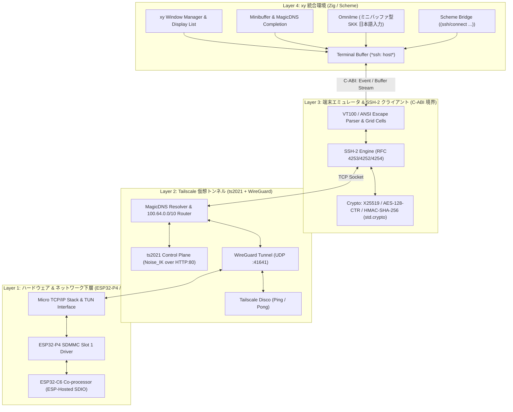

# SSH Terminal & Tailscale Integration into nihos (`xy`)

2026年11月1日。MeOS（[`/Users/masanork/repo/MeOS`](file:///Users/masanork/repo/MeOS)）で実証された軽量ベアメタルネットワーク技術（ESP32-C6 SDIO、自前マイクロTCP/IP、Tailscale ts2021/WireGuard、SSH-2クライアント）をnihosへ移植・統合し、nihosの中核環境である統合環境 `xy` からシームレスに操作できる端末・ネットワーク環境を構築する設計仕様。

関連文書：
- [`xy` アーキテクチャ仕様](xy-architecture.md)
- [アプリケーション構成案](learning-applications.md)
- [C6 ネットワークオフロード設計](c6-network-offload.md)
- [MeOS SSH Client 実装](file:///Users/masanork/repo/MeOS/user/ssh/ssh_app.c)
- [MeOS Tailscale 実装](file:///Users/masanork/repo/MeOS/user/tailscale/tailscale_app.c)
- [MeOS Tab5 Wi-Fi/TCP ドライバ](file:///Users/masanork/repo/MeOS/drivers/wifi/wifi_tab5.c)

---

## 1. 目的と基本設計原則

### 1.1 目的
- **Convivial Machine の実現**: 独立したshellや単体TUIアプリを乱立させず、起動直後から常駐する統合環境 `xy` の「バッファ」「ミニバッファ」「Scheme評価器」から直接SSH接続を行い、学習・開発・リモートマシン操作を同一のS式・エディタ体系で行えるようにする。
- **ゼロコンフィグなプライベート接続**: Tailscale（ts2021 + WireGuard + MagicDNS）をバックグラウンド統合し、外出先やNATの内外を意識せず `(ssh "my-macbook")` や `M-x ssh my-macbook` で即座にピアと暗号化通信を確立する。
- **SSHクライアント端末に特化**: 外部からの待ち受けポートや攻撃サーフェスを最小化するため、SSHサーバーは持たず、クライアント端末機能とVPNトンネルに特化して極限までフットプリントを削る。

### 1.2 アーキテクチャ階層



---

## 2. C-ABI 境界仕様 (`include/nihos/net_terminal.h`)

`xy`（Zigコア）とネットワーク・SSH・端末エンジン（C/Zig共有コード）の間を疎結合に保つため、安定したC-ABIインターフェースを定義する。

### 2.1 データ構造

```c
#ifndef NIHOS_NET_TERMINAL_H
#define NIHOS_NET_TERMINAL_H

#include <stdint.h>
#include <stdbool.h>
#include <stddef.h>

#ifdef __cplusplus
extern "C" {
#endif

#define NIH_TERM_MAX_TITLE      48
#define NIH_TS_MAX_PEERS        64

/* 端末グリフ属性 (1280x720 MIPI-DSI レンダリング用) */
typedef struct {
    uint32_t codepoint;     /* Unicode UTF-32 */
    uint16_t fg_rgb565;     /* 前景色 */
    uint16_t bg_rgb565;     /* 背景色 */
    uint8_t  flags;         /* bit0: bold, bit1: underline, bit2: reverse */
} nih_term_cell_t;

/* 端末グリッド状態のスナップショット */
typedef struct {
    uint16_t cols;
    uint16_t rows;
    uint16_t cursor_col;
    uint16_t cursor_row;
    bool     cursor_visible;
    const nih_term_cell_t *cells; /* cols * rows 配列 */
} nih_term_view_t;

/* Tailscale 状態 */
typedef enum {
    NIH_TS_STOPPED = 0,
    NIH_TS_CONNECTING,
    NIH_TS_NEEDS_LOGIN,
    NIH_TS_RUNNING,
    NIH_TS_ERROR,
} nih_ts_state_t;

typedef struct {
    char     hostname[48];
    uint8_t  ip[4];
    bool     online;
} nih_ts_peer_t;

typedef struct {
    nih_ts_state_t state;
    uint8_t        my_ip[4];
    char           hostname[32];
    char           auth_url[160];
    int            peer_count;
    nih_ts_peer_t  peers[NIH_TS_MAX_PEERS];
} nih_ts_status_t;

/* =========================================================================
 * Tailscale サブシステム API
 * ========================================================================= */
bool nih_tailscale_init(void);
bool nih_tailscale_up(const char *auth_key);
void nih_tailscale_down(void);
void nih_tailscale_get_status(nih_ts_status_t *out);
bool nih_tailscale_resolve(const char *hostname, uint8_t out_ip[4]);

/* =========================================================================
 * SSH 端末セッション API
 * ========================================================================= */
typedef struct nih_ssh_session nih_ssh_session_t;

typedef void (*nih_term_dirty_cb_t)(void *user_ctx);

nih_ssh_session_t *nih_ssh_create(uint16_t cols, uint16_t rows, nih_term_dirty_cb_t cb, void *user_ctx);
bool nih_ssh_connect(nih_ssh_session_t *s, const char *host, uint16_t port, const char *user, const char *pass);
void nih_ssh_disconnect(nih_ssh_session_t *s);
void nih_ssh_destroy(nih_ssh_session_t *s);

/* 入出力操作 */
void nih_ssh_send_input(nih_ssh_session_t *s, const uint8_t *bytes, size_t len);
void nih_ssh_resize(nih_ssh_session_t *s, uint16_t cols, uint16_t rows);
void nih_ssh_poll(nih_ssh_session_t *s); /* 受信・ステートマシン駆動 */
void nih_ssh_get_view(nih_ssh_session_t *s, nih_term_view_t *out_view);

#ifdef __cplusplus
}
#endif

#endif /* NIHOS_NET_TERMINAL_H */
```

---

## 3. `xy` へのシームレス統合設計

### 3.1 端末バッファ（Terminal Mode）の設計
- **モード構造**: `xy` のバッファ種別に `terminal` を追加。
- **レンダリング変換**:
  - `nih_ssh_get_view()` から得られる `nih_term_cell_t` の2次元配列を走査。
  - 各セルの `(col, row)` 座標を、現在のフォントサイズ（例: 8×16ピクセル、160桁×45行）に基づきピクセル矩形へマップ。
  - `xy` の共通描画キュー（`PlacedGlyph` / 矩形フィル）へ直接投入。フォントラスタライザ（`src/graphics/ttf.zig`）のキャッシュ済み8bpp αビットマップを再利用するため、Tab5の1280×720解像度で美しく鮮明に描画可能。
- **スクロールと履歴**:
  - PSRAM上に256行のリングバッファを保持。
  - `PgUp` / `PgDn` やタッチスワイプでエディタ同様にスムーズな履歴スクロールをサポート。

### 3.2 ミニバッファ・SKK・Scheme との連携
1. **ミニバッファからのホスト起動 (`M-x ssh`)**:
   - `M-x ssh` 入力時、`nih_tailscale_get_status()` を参照して接続可能なTailscaleピア名（`my-macbook`, `dev-server` など）を補完候補に提示。
   - `Enter` で即座に `*ssh: dev-server*` バッファを生成して接続。
2. **SKK日本語入力の共有**:
   - 端末バッファ上でSKKモードに入ると、エディタと同じミニバッファ型SKKが立ち上がる。
   - 漢字変換確定後、UTF-8バイト列としてリモートのSSHチャネルへ一括投入。
3. **Scheme S式バインディング**:
   ```scheme
   ;; S式から直接SSHコマンドを実行し、結果を現在のバッファへ挿入
   (define uptime-str (ssh/run "dev-server" "uptime"))
   (buffer/insert! (current-buffer) uptime-str)
   ```

---

## 4. 4段階の実装ロードマップ

### フェーズ 1: MeOSコードの検証とC-ABIバインディング（現在）
- MeOSの `tailscale_app.c` と `ssh_app.c` からTUI/GUI依存コードを除去し、プロトコル・暗号・端末ステートマシンのコアを抽出。
- `include/nihos/net_terminal.h` を配置し、ホスト環境およびターゲット環境でビルド可能なモジュールとしてリンク検証。

### フェーズ 2: `xy` の端末バッファ（Terminal Mode）実装
- `src/xy/terminal_buffer.zig` を実装。
- `nih_term_view_t` を `viewport_layout` / `PlacedGlyph` 表示リストに変換するアダプタを作成。
- キー入力イベントを `nih_ssh_send_input()` に転送する入力ルーティングを確立。

### フェーズ 3: ミニバッファ＆MagicDNSホスト補完の結合
- ミニバッファコマンド `M-x ssh` を `xy` に追加。
- Tailscaleピア一覧からのホスト名自動補完を実装。
- 接続状態（Connecting / Connected / Closed）のモードライン表示。

### フェーズ 4: 暗号のZigネイティブ化とSchemeバインディング拡充
- X25519, ChaCha20-Poly1305, HMAC-SHA256 を Zig標準の `std.crypto` に順次置き換え（ゼロアロケーション・メモリ安全化）。
- Scheme環境（`scheme_bridge.zig`）に `ssh/*` プリミティブを登録し、S式による自動化を可能にする。
