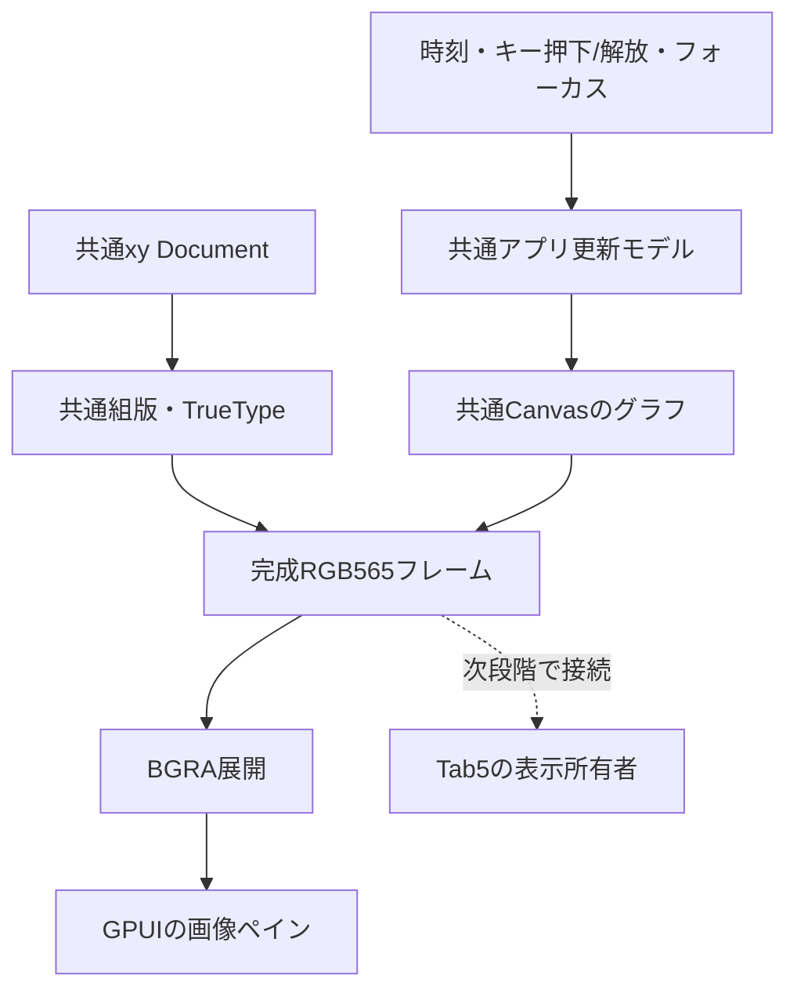

# xy: GPUI共通描画、アニメーション、R7RS-smallへの段階

## 今回の実装

`apps/xy-gpui`は実際のGPUIウィンドウを作り、共通Zigのxy描画とグラフを並べる。
既存CocoaホストのSQLite/source編集機能を置き換えたという意味ではない。
GPUIはイベント・フォーカス・レイアウト・画像転送、共通コアは文字・組版・画素を担当する。

`src/app/animation.zig`は単調時刻を呼出側から受け、16,667usの固定刻みで更新する。
1回の追いつき処理は4stepまでで、超過時間は計測して捨てる。pause中と時計巻戻り時は
再基準化し、再開時に過去の時間を一括実行しない。押し続けによる再トグルを抑制し、
フォーカスを失うとheld状態を解放して停止する。

グラフは固定小数点のsine tableを使い、native整数ABIに浮動小数点状態を要求しない。
軸・文字の背景は再利用する。共有RGB565→BGRA変換の後だけGPUIへ渡し、
画像の保持・atlas退役もホストが管理する。停止中の定期再描画は要求しない。

SDLは将来のbackend/互換API候補として残す。今回SDLを追加する理由はなく、既存の
Canvas/SurfaceをGPUI内へ接続して画素の正本を維持する。SDLをMacだけへ導入しても
Tab5との描画エンジン共有にはならない。採用時は両環境の同一描画経路または明示的な
backend差を測定し、互換範囲を定める。

## 次の接続と受入条件

| 順序 | 対応 | 受入条件 |
| --- | --- | --- |
| 1 | GPUI pane・時計・停止/再開・キー | 今回実装。単体/画素比較と実ウィンドウを分けて記録 |
| 2 | versioned app event/frame API | 時刻、press/release/held、focus/cancel、frame所有と退役、サイズ/時間/メモリ上限 |
| 3 | Scheme callbackとplot library | `(nihos app)`と`(nihos graphics)`を標準言語から分離。評価中断後も編集可能、停止後にcallbackが残らない |
| 4 | WAMR実験の通常サービス接続 | 別worktreeの実験を監査して統合。MeOSのSnake等をadapter経由で起動→入力→終了→xy復帰。trap/中断でも資源回収 |
| 5 | Tab5で同じモデルを描画 | 実候補で入力遅延・frame時間・転送量・PSRAM/SRAM・tearingを測定。host/RV32 linkを実機成功と扱わない |

MeOSの手元ソースは`apps/wasm/{snake,tetris,shooter}.c`と`apps/wasm/meos.h`を参考にした。
時刻・キー・矩形/画像/文字・sleep/presentで動いている。nihosではフレーム公開を
入力pollやsleepの暗黙の副作用へせず、更新・描画・公開を明示して扱う。
ゲームにはrelease/heldが必要だが、現行Tab5 Keyboardの編集用adapterはreleaseを捨てるため、
device側入力との接続には追加実装が必要である。

## R7RS-smallの差分

現行`scheme_runtime.zig`は256 cells、64-byte token、深さ24、1024stepの限定処理系。
closureと要求間GCはあるが、R7RS準拠ではない。今回その意味論は変更していない。

| 整備対象 | 実装上の要点 |
| --- | --- |
| proper tail recursion | Zig再帰スタックへの依存を外し、末尾呼出しで評価frameを増やさない |
| 中断/再開とGC | 実行予算をホスト方針として分離。継続中の評価stack・closure・callbackをGC rootとして保持 |
| reader/標準データ | 文字・vector・bytevector・可変長引数・引用記法・数値読取りとUnicode文字列操作 |
| `syntax-rules` / libraries | 衛生的macro、`define-library`・import/export、標準bindingの適合表 |
| control / conditions | 多値、継続、`dynamic-wind`、parameter、例外、portを段階実装 |
| 数値 | 対応範囲を明示。数値塔全体を必須とせず、数理用の実数・三角関数を含む実用構成を測定 |

まず仕様例と既存処理系で差分テストを作り、独自VM改良とChibi等を同じeditor binding込みで
比較する。code/heap、GC停止時間、cancel遅延、既存拡張の互換性を測定してから実行系を決める。
R7RS適合と描画/ゲームAPIの実装完了は別に判定する。

参照: [R7RS-small report](https://small.r7rs.org/attachment/r7rs.pdf)、
[Chibi](https://github.com/ashinn/chibi-scheme)、
[GPUI 0.2.2 RenderImage](https://docs.rs/gpui/0.2.2/gpui/struct.RenderImage.html)、
[SDL software renderer](https://wiki.libsdl.org/SDL3/SDL_CreateSoftwareRenderer)。
