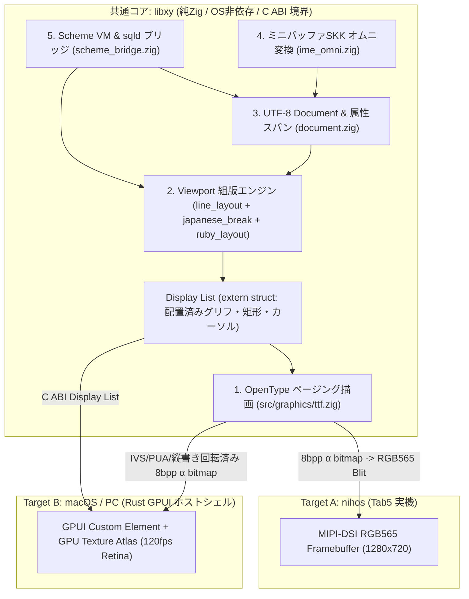

# `xy` アーキテクチャと `src/graphics/ttf.zig` 設計仕様

2026年10月30日。統合環境 `xy` を `nihos`（Tab5実機）の専用ユーザーランドの中核としつつ、同じZigコア（`libxy`）をC ABI経由でmacOS/PC上のGPUI（Metal/Vulkan）バックエンドからも駆動できるデュアルターゲット構成として設計する。

関連文書：
- [アプリケーション構成案](learning-applications.md)
- [エディタ拡張言語とScheme × SQLite統合](editor-extension-language.md)
- [SQLite integration](sqlite-integration.md)
- [Tab5 storage feasibility](tab5-storage-feasibility.md)

---

## 起動面と操作体系（2026-10-31の方針確定）

通常起動はスプラッシュから `xy` の作業バッファへ直接進む。独立したlauncher、
ASCII shell、別エディタを日常操作の入口として増設せず、編集・読書・辞書・
システム観察を同じバッファ、ミニバッファ、コマンド登録とScheme bindingへ集約する。
文書内の統合環境名は `xy` とする。

- 初期画面は短いヘッダと編集可能な `*scratch*`。常設のコマンド一覧や重複する
  起動案内を置かず、説明は明示的に開くhelpバッファへ出す。
- 既存エディタの通常操作と保存は共通Document APIへ収束させる。読み取り専用の
  書籍・辞書・ログ・メモリ・タスク表示も同じ表示面のmodeとして扱う。
- コマンド、keymap、hook、mode、選択範囲やS式の評価をSchemeから登録・変更する。
  ボタン、キー操作、ミニバッファは同じコマンドを呼ぶ。全操作にS式の手入力を
  要求せず、利用者が必要な箇所から環境を改造できるようにする。
- Zig coreとsystem serviceが文書、組版、描画、入力、保存と資源管理を担い、
  Schemeにはその操作APIを公開する。デバイスの生ポインタやDMA操作へ直結させる
  ことを「全機能のbinding」とは呼ばない。

boot/faultの診断記録と復旧経路は通常UIから独立して維持する。起動失敗時の復旧に
Schemeの正常起動を前提とせず、常用shellを残すこととは分ける。移行中の既存shellは
診断用の暫定入口であり、機能追加の主線にしない。

現在の `scheme_bridge.zig` は固定フォームを扱う限定的なS式評価器、Document操作、
表示設定、クエリhookのhost向け接続を持つ。一般の `define` / `lambda`、closure、
macroによる拡張、実機のScheme VM、永続 `sqld` とU-mode隔離の接続が完成したという
意味ではない。ネイティブの通常起動もまだ `xy` へ接続されていない。

実装の直近の順序は、(1) 共通Documentを使うRAM上の `*scratch*` と入力・描画を
通常起動へ接続、(2) ログ・メモリ・タスク観察をバッファとして公開、(3) 本格的な
Scheme評価とコマンド登録・再定義・中断を接続、(4) 保存、読書、辞書を同じmode機構へ
載せる。RAMでの起動経路はSQLite、辞書、IMEの全機能完成を待たずに進める。
利用者のScheme定義でキー動作を変更でき、評価エラーや中断後にも本文と操作が残る
ことを、programmableな環境になったかの受け入れ条件とする。

## 1. 設計原則とデュアルターゲット境界（`nihos` / `GPUI` 共通コア）

`xy` のコアロジック（UTF-8編集、書記素・IVS境界、禁則・ルビ・縦横組版、SKKオムニ変換、Scheme評価器とSQLiteデータモデル接続、`ttf.zig` ラスタライザ）は、特定のOSやフレームバッファ形式に直接結合させず、**ヒープアロケーションを持たない純Zigモジュール群**として実装する。



- **Display List による分離**:
  組版エンジン（Module 2）の出力は、直接ピクセルを塗る副作用ではなく、`extern struct` で定義されたフラットな **Display List（配置済みの `GlyphKey` + 26.6固定小数点座標 `(x, y)` + 矩形/選択範囲/カーソル）** とする。
- **Mac/PC（GPUI）とTab5での完全な組版・字形一致**:
  macOS等のホスト環境でも、OS標準のCoreText等に丸投げするとBunsen 3レイヤ（本体・Ext・PUP）のIVS横断解決や、`vert` テーブルを持たないフォントの縦書き約物回転、グループルビの配置がTab5実機と乖離する。そのため、GPUIバックエンドでもグリフ解決・ベジェ縦書き変換・ラスタライズには共通の `src/graphics/ttf.zig` を使い、生成された 8bpp α ビットマップをGPUIのテクスチャアトラスへ供給する。

---

## 2. Module 1: `src/graphics/ttf.zig` 仕様

特定のフォント名をハードコードせず、汎用的なページングOpenType/TrueTypeエンジンとして `src/graphics/ttf.zig` を実装する。初期の標準ターゲットにはBunsen明朝・ゴシックの3レイヤ×2書体（計6ファイル、127,597グリフ）を据える。

### 2.1 データ読み出し抽象（`SliceReader`）
メモリ上のスライス（テストや内蔵Flashのフォールバックフォント）と、SDカード上の大型 `.ttf` ファイル（50〜65 MiB）の双方を同一のコードで扱うため、オフセット指定の読み出しコールバック `SliceReader` を介してアクセスする。

```zig
pub const SliceReader = struct {
    context: *const anyopaque,
    readFn: *const fn (ctx: *const anyopaque, offset: u32, buf: []u8) Error![]const u8,

    pub fn read(self: SliceReader, offset: u32, buf: []u8) Error![]const u8 {
        return self.readFn(self.context, offset, buf);
    }
};
```

### 2.2 テーブル解析と2パスIVS解決（`Face` と `Family`）
- **対象テーブル**: `head`、`hhea`、`maxp`、`cmap`（Format 4 / Format 12 / Format 14）、`loca`（short `u16` / long `u32` 両対応）、`hmtx`、`glyf`。
- **`Family` によるマルチレイヤ解決（2パス方式）**:
  複数の `Face`（例：`[本体, Ext, PUP]`）を束ねる `Family.resolve(base_cp, ivs_cp)` は、以下の順序で `glyph_id` を解決する：
  1. `ivs_cp != 0` の場合、まず全レイヤの `cmap` Format 14（Default UVS / Non-Default UVS）を先頭レイヤから横断検索する。これにより、基底文字が本体にあり対応するIVS字形が `Ext` にある場合でも、本体の基底文字へ誤ってフォールバックせず `Ext` の正しいIVS字形を選択できる。
  2. Format 14 で見つからなかった場合（または `ivs_cp == 0` の場合）、全レイヤの `cmap` Format 12（または Format 4）を先頭レイヤから検索する。

### 2.3 `glyf` 展開（Simple Glyph ＋ 深さ1 Composite Glyph）
- **Simple Glyph (`numberOfContours >= 0`)**:
  `endPtsOfContours`、繰り返しフラグを含む `flags`、デルタ符号化された `xCoordinates` / `yCoordinates` を呼び出し側提供の固定長頂点バッファへ展開する。TrueType仕様に従い、連続するoff-curve制御点の中間には暗黙のon-curve中点を補間する。
- **Composite Glyph (`numberOfContours < 0`)**:
  Bunsen 6ファイルには複合グリフが含まれないが、欧文等の汎用フォント互換性のため、**再帰を使わない深さ1・最大4部品のループ展開（平行移動オフセット `(dx, dy)` のみ）** をサポートする。これによりヒープ消費 0 B、スタック増加数十バイト以内で複合グリフに対応する（回転・拡大縮小行列を伴う複合グリフは `error.UnsupportedCompositeTransform` とする）。

### 2.4 ベジェ空間での縦書き（Vertical Writing）座標変換
`vertical == true` の場合、ラスタライズ前のem座標空間（整数頂点）で以下の変換を適用する：
1. **90度時計回り回転**: 括弧類（`「」『』（）［］｛｝〈〉《》【】〔〕`）、三点リーダー・二点リーダー（`…‥`）、ダッシュ（`―`）は、em正方形中心基準で90度時計回り回転 $(x', y') = (y, \text{upm} - x)$ を適用する。
2. **長音符・波ダッシュ変換**: `ー`（U+30FC）、`〜`（U+301C）、`～`（U+FF5E）は縦書き用の向きになるよう90度回転＋反転補正を行う。
3. **句読点・小書き仮名の平行移動**: 句読点（`、。，．`）は右上方向 $(+0.55\,\text{upm}, +0.55\,\text{upm})$ へ、小書き仮名（`ぁぃぅぇぉっゃゅょゎァィゥェォッャュョヮ`）は $(+0.10\,\text{upm}, +0.10\,\text{upm})$ へ平行移動する。

### 2.5 2次ベジェ・スキャンラインラスタライザと2段キャッシュ
- **ラスタライザ**: 2次ベジェ曲線を再帰なしの固定ステップ分割で線分化し、サブピクセル・スキャンライン（Non-Zero Winding）で 8bpp グレースケール（α カバレッジ `0..255`）を生成する。
- **2段キャッシュ（PSRAM 512 KiB 枠内）**:
  1. **Outline Cache（192 KiB）**: `(style, layer_id, glyph_id)` をキーに、SDから読み出した生の `glyf` バイトスライス（中央値 876 B）を保持する。サイズ変更や縦横切替時はこのキャッシュから再ラスタライズすることでSD I/Oをゼロにする。
  2. **Bitmap Cache（320 KiB）**: `(base_cp, ivs_cp, px_size, style, vertical)` をキーに、ラスタライズ済みビットマップと26.6固定小数点メトリクスを保持する。

---

## 3. Module 1〜5 の実装配置と接続インターフェース

- **Module 1（OpenTypeページング描画）**: [ttf.zig](../../src/graphics/ttf.zig) — 2パスIVS解決（`Family.resolve`）、Simple/深さ1 Composite `glyf` 展開、em空間縦書き座標変換、4×サブピクセル・スキャンラインラスタライザ、2段キャッシュ（`TwoTierCache`）を提供。
- **Module 2（Viewport組版）**: [viewport_layout.zig](../../src/graphics/viewport_layout.zig) — [line_layout.zig](../../src/graphics/line_layout.zig)、[japanese_break.zig](../../src/graphics/japanese_break.zig)、[ruby_layout.zig](../../src/graphics/ruby_layout.zig) を用い、[ttf.zig](../../src/graphics/ttf.zig) から得た 26.6 固定小数点送り幅で1画面分の `PlacedGlyph`（C-ABI Display List）配列を生成する。
- **Module 3（Document）**: [document.zig](../../src/xy/document.zig) — UTF-8正本、拡張書記素クラスタ（IVS・結合濁点対応）単位のカーソル操作・削除、グループ化Undo、ルビ範囲・非破壊SKK `PreeditOverlay` を管理する。
- **Module 4（SKKオムニ変換）**: [ime_omni.zig](../../src/xy/ime_omni.zig) — ローマ字→かな変換と `▽` 先頭のプレフィックス（無印 / `?` / `~` / `&` / `@` / `:` / `(...)` / カスタム拡張）に応じて `sqld`（`skk_dict`、`gjs.db`、`books`、`notes`、`sys_config`）やScheme評価器を呼び出し、ミニバッファに候補ストリームを表示する。
- **Module 5（Scheme & `sqld` ブリッジ）**: [scheme_bridge.zig](../../src/xy/scheme_bridge.zig) — `XyWorkspace` として全モジュールを統合し、`(view/set! #:font ... #:size ... #:direction ...)` によるリアルタイム組版変更・世代ロールバック `(sys/config-rollback!)`・バッファ編集 `(buffer/...)`・宣言的クエリ `(q ...)`・`▽(...)` ライブ評価を提供する。
- **デュアルターゲット描画アダプタ（Target A: RGB565 / Target B: GPUI）**: [render_adapter.zig](../../src/xy/render_adapter.zig) — [surface.zig](../../src/graphics/surface.zig) の RGB565LE 8bpp マスク合成（`paintSurfaceRgb565`）と、macOS/PC の GPUI ホスト向けゼロコピー C-ABI フレーム記述子（`GpuiFrameDescriptor` / `GpuiGlyphQuad`）の双方へ `PlacedGlyph` Display List を出力する。
